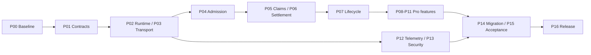

# JoobQ / JoobQ Pro enterprise v1 implementation plan

Status: proposed execution plan, 2026-10-29. No milestone is complete merely because it appears here. Scope: all findings in [the architectural audit](production-v1-audit.md), including completing the advertised Pro features. Current local patches and test results are recorded in [validation.md](validation.md). This plan does not authorize a production cutover or claim that v1 is ready.

## PR #19 is part of the implementation baseline

Review update, 2026-10-29: incorporate [PR #19](https://github.com/azutoolkit/joobq/pull/19) at **`498ac5f5f0c7e78f35f9fd380f2290495c3022e1`** before implementing overlapping work. See the [source comparison, local tests and integration checklist](pr-19-reconciliation.md). The original audit remains a historical snapshot; its absence claims about URL/TLS/ACL support and simple configured-store lookup do not describe this PR head.

| Package / findings | PR #19 contribution to preserve | Revised remaining work |
| --- | --- | --- |
| P02 / F22 | Configured-store lookup fixed; positive two-server tests | Extend to independent runtimes, cached consumers and Pro routing; do not reimplement the singleton fix |
| P04 / F05 | Strict `add!` / `JoobQ.enqueue`, errors and forced named-queue routing | Add durable receipts/Unknown resolution and strict per-item batch semantics; migrate legacy paths |
| P06 / F06 | Strict `add_delayed` producer API | Preserve API; finish durable promotion, leases, quarantine and fairness |
| P03/P13 / F10 | URL, ACL auth, verified TLS/hostnames, configuration precedence and fail-closed reconnect | Extend transport deadlines across both constructors; test successful rotation, SNI needs and production ACLs |
| P13 / F13/F14 | Deprecation header and URL credential-inspection protection | Authenticate/authorize management operations and fix legacy client redaction |
| P00/P16 / **F32** | Strict URL parser exposes old CI configuration | Replace invalid `REDIS_URL: redis:6379`; make TLS/second-server release tests mandatory |

Local PR-only validation: **76 focused examples passed with 4 Crystal workers, real TLS Redis, ACLs and a second Redis; no pending tests**. GitHub API access was denied, so hosted checks/approval/merge status are not asserted. This planning update does not merge PR #19 or validate a combined core/Pro branch.

Revised first sequence: pin/review PR #19 → correct its CI URL/configuration assumptions → integrate current master and replay distinct audit mitigations → run full paired suites on the combined SHAs → continue the residual packages below. P01 ADRs can proceed while that baseline is prepared.

## Outcome and non-negotiable release criteria

Deliver coordinated core and Pro 1.0.0 releases with:

1. At-least-once delivery, explicit admission outcomes, fenced claim/settlement ownership and continuous recovery. Every durably accepted ID remains recoverable or has an authoritative terminal disposition.
2. Documented, tested durability for named failures/topologies. Zero accepted-job loss in the supported fault model; no promise of exactly-once external side effects. Provide an idempotency/outbox integration example for those effects.
3. Bounded fibers, memory, connections, backlog admission and shutdown; recovery after network outages without permanently dead worker loops.
4. Working batches, uniqueness, rate limiting, workflow deadlines/reconciliation, verified TLS and privileged management API controls.
5. Real Prometheus/OTel integrations and structured, redacted logs that cannot stall job processing when an exporter fails.
6. A reproducible >=35,000 successfully settled jobs/sec benchmark on a declared reference workload/topology with durability and normal telemetry enabled, plus realistic workload and chaos/soak evidence.
7. No unresolved release-blocking findings, no skipped mandatory integration tests, hosted CI on the release tree, tested schema migration/rollback boundaries and verified release artifacts.

**Scope defaults:** Crystal 1.22.x; Redis 7.4 and 8.0 as the initial test matrix; core and Pro tested as one pinned dependency graph. One primary per namespace is the first supported storage topology. Redis Cluster is explicitly unsupported for v1 unless a separate hash-slot-safe architecture is implemented and tested. Existing LIFO behavior stays in compatibility mode; an explicit FIFO option and fairness policy belong in the v1 API. Pro's advertised features are to be completed, not quietly removed from the acceptance criteria.

Owner names below are accountable roles, not assignments to specific people. Dates follow design/prototype evidence; the plan uses exit criteria rather than speculative release dates.

## Execution order and review boundaries

Use small reviewed PRs in both repositories, starting from the reviewed PR #19 feature baseline and preserving the distinct local regression fixes. Cross-repository CI must test the exact paired SHAs, not whichever core master happens to resolve. Put the dependency changes and migration notes in the same review sequence as the code they affect.

| Wave | Work packages | Accountable role | Depends on | Exit condition |
| --- | --- | --- | --- | --- |
| 0 — Baseline and contracts | P00–P01 | Release + architecture | Existing audit | Reproducible baseline and written delivery/durability/schema/SLO contracts |
| 1 — Shared runtime and Redis transport | P02–P03 | Runtime | P01 | Correct store routing, bounded transport, explicit ambiguous-write handling |
| 2 — Core durable state machine | P04–P06 | Core | P02–P03 | Replay-safe admission, leased ownership, recoverable settlement and scheduler fairness |
| 3 — Worker lifecycle | P07 | Runtime + core | P05–P06 | Global resource budgets and tested bounded drain/recovery |
| 4 — Pro correctness | P08–P11 | Pro | P04–P07 | Reconciled workflows, complete batches, fenced uniqueness and atomic rate admission |
| 5 — Observability and security | P12–P13 | Observability + security | P02; finish against P07–P11 | Exporters, safe logs, TLS/ACL rotation, authorized management operations |
| 6 — Migration and operational proof | P14–P15 | Platform + release | P06–P13 | Upgrade, restore, fault and performance acceptance evidence |
| 7 — Release | P16 | Release | Every earlier gate | Reviewed v1 artifacts match the validated release tree |

Build the fault harness in P00 and extend it with each PR; do not postpone correctness tests until wave 6. Security and observability foundations may progress alongside core changes once the runtime contracts are fixed. Correctness is a prerequisite for throughput optimization.

## Work packages

### P00 — Preserve fixes and make the evidence reproducible

**Repositories:** both. **Owner:** release engineering.

- Pin PR #19 and integrate its feature baseline with current master; review and replay the existing local safety patches, regression tests, JSON formatting, README corrections and crash probe as bounded PRs. Resolve `redis_store.cr`/README/workflow overlap without dropping URL/TLS/ACL or strict enqueue behavior. Preserve before/after evidence; these patches are mitigations, not completion of the audit.
- Replace worktree dependency symlinks in release CI with fresh, pinned checkouts/shard installs; record compiler, Redis, dependency versions and both repository SHAs in artifacts. Libraries need compatible version constraints; CI also needs an exact resolved graph.
- Create owned Redis/process/fault-proxy fixtures with unique directories, ports and namespaces, strict timeouts and cleanup. No tests may discover and flush a developer/production Redis.
- Convert the three pending core cases into deterministic tests: concurrent enqueue, Queue#start processing, automatic delayed scheduling. Retain PR #19's positive store-wiring tests, make the second server mandatory and broaden isolation tests in P02.
- Fix F32: the PR and local audit workflow both still set invalid `REDIS_URL: redis:6379`; use `redis://redis:6379/0` or deliberately omit the URL for the legacy constructor matrix. Require actual TLS Redis/OpenSSL fixtures and fail mandatory jobs on fixture skips. Compile the new BaseQueue abstract methods against Pro/custom consumers.
- Add a mandatory-test manifest so missing Redis or unexpected `pending` fails release CI. Preserve the 1/4-worker matrix and run contention tests at 8 workers in scheduled stress jobs.

**Gate:** clean checkout passes on the existing supported graph; all new mitigations have regressions; known pending tests are tracked for conversion, and none are silently counted as proof. P00 may establish a documented failing baseline; P16 may not release it.

### P01 — Freeze guarantees and the storage protocol before rewriting it

**Repositories:** both, design/ADRs. **Owner:** architecture with platform.

Write reviewed ADRs for:

- Delivery: typed `Accepted(receipt)`, `Rejected(reason)` and `Unknown(request_id)` results, plus a receipt lookup/retry API. Compatibility wrappers must raise typed errors rather than swallow them. Batch admission returns per-item outcomes.
- Identity: producer request ID, immutable job ID, attempt, claim token and runtime/session identity are distinct. Define deduplication retention and reject reuse of an ID with a different payload. The guarantee cannot outlive its retained deduplication evidence without an explicit policy.
- Authority: one canonical versioned job/transition record per logical state, with indexes and notifications treated as derived. CAS/token checks and a single authoritative mutation are the commit boundary; do not reintroduce a multi-key “all or nothing because Lua” assumption. A committed transition carries enough intent to reconstruct its effects after partial index/outbox updates.
- Failure model: worker crash, Redis process crash with intact storage, disconnect/lost reply, OOM/write refusal, replica failover and storage loss are separate cases with separate recovery obligations.
- Ordering, expiry, fairness, scheduling clock, retry budget, terminal retention and poisoned-payload quarantine. Use Redis time for shared lease/rate decisions and monotonic local deadlines for waiting; test clock steps.
- Schema/API upgrade path and the measurable performance profiles described below.

**Durability decision:** the first lab profile uses dedicated noeviction Redis with AOF `appendfsync=always`, verified backups and fail-closed admission when the configured acknowledgement policy cannot be met. Test any replication/persistence acknowledgement barrier on the same leased connection as the authoritative write. `WAIT`/`WAITAOF` alone do not prove safe automatic primary promotion. If zero loss across primary/disk loss or arbitrary failover is required, add a durable, replicated authoritative journal with a proven recovery/promotion policy, or keep that topology unsupported. An asynchronous replica must never be advertised as a zero-loss solution by configuration alone.

**Gate:** an executable state-machine model and invariant list; selected commit/receipt protocol handles lost replies without deleting evidence or duplicating logical admission. Prototype its recovery and cost before approving the schema. If the protocol cannot satisfy the stated failure model, change the architecture before progressing.

### P02 — Introduce explicit runtime dependency injection

**Touch points:** core configuration/store/queue/registry/latency/DLQ; Pro Runtime, Worker, Store, metrics, batches, uniqueness and rate limiting.

- Add a Runtime/RuntimeContext holding the store, namespace, transport policy, clocks, instrumentation and resource budgets. Construct queues, schedulers and Pro services from it.
- Preserve PR #19's `configured_store?`/`RedisStore.instance` correction for the default runtime. Eliminate hidden global lookups within independently injected services, and test consumers constructed before configuration replacement as well as newly constructed ones. Prevent one workflow worker from silently changing another worker's runtime.
- Validate history and activity-transport routing at startup. Explicitly configured separate stores require a durable bridge/outbox; otherwise reject the mismatch.

**Gate:** run two runtimes against two Redis servers in the same process. Jobs, histories, metrics, retries, locks and registries stay on the correct server/namespace. Same-runtime components share the expected transport; mismatches fail before starting fibers. No arbitrary sleep-based assertions.

### P03 — Make the Redis transport bounded and replay-aware

**Touch points:** RedisStore, redis_pool_safety, redis_pipeline and the Redis adapter/dependency.

- Pin the pool compatibility contract or replace the monkey patch with a maintained adapter; preserve contention/capacity tests. Validate capacities/timeouts at all configuration entry points, including ENV and direct constructors.
- Extend PR #19's `RedisEndpoint`/`RedisClient`/`RedisPool` rather than building a second URL/TLS adapter. Carry one absolute request deadline through checkout, DNS, connection/TLS/auth/SELECT, write/read and reconnect. Both host/port and URL constructors must receive the policy; PR #19's URL pool currently leaves command_timeout nil. Each stage receives the remaining budget. Discard unusable connections and return capacity on every failure.
- Classify pre-send failure versus unknown post-send outcome; disable generic replay of mutating commands. Retry only receipt-aware/idempotent operations with bounded exponential backoff and jitter.
- Add shared circuit state with bounded half-open probes. Recover after outages longer than restart windows; never permanently exhaust worker restart allowance because Redis was unavailable. Expose state and attempt counters.
- Rewrite generic pipeline helpers to use the supplied pipeline connection. Bound batch size and bytes; preserve per-item/partial outcomes. Protect stats and compute finite averages from updated counts. Avoid nested checkout while holding a connection.

**Gate:** deterministic pool saturation, DNS/connect/TLS/auth stalls, server pause, connection reset before/after execution, lost response and multi-thread stress. Deadlines include setup time, checked-out capacity returns, non-idempotent writes are not silently replayed, and recovery does not require process restart. Small pool sizes must not deadlock pipeline helpers.

### P04 — Durable producer admission and idempotent receipts

**Touch points:** Job, Queue enqueue APIs, Store, admission scripts/records.

- Build on PR #19's strict `Queue#add!`/`JoobQ.enqueue` and named-queue enforcement; retain `UnknownQueue` and malformed-payload behavior. Implement the P01 canonical envelope/receipt protocol and payload validation. Make queue membership repairable from accepted records, including crash after authority commit but before index update.
- Retain request-to-result evidence, enforce payload digest consistency and propagate typed failures through single/batch enqueue. Support bounded producer backpressure; reject before durable acceptance when limits cannot be satisfied.
- Supply an application transactional-outbox example and a side-effect idempotency example. Do not pretend a queue enqueue is atomic with an unrelated application DB commit.

**Gate:** simultaneous producers and repeated/reordered requests create one logical admission per request ID. Drop replies after each write boundary; resolving/retrying an Unknown returns the existing receipt. Partial batch failures identify each item's status; acknowledged IDs remain enumerable and recoverable.

### P05 — Distributed claims, leases and ownership fencing

**Touch points:** Store claim API/scripts, worker registry, reaper, queue startup; new typed Claim record.

- Reserve a bounded batch with unique claim tokens, owner/session identity, attempt and visibility deadline. Stable IDs replace JSON payload matching in acknowledgements.
- Atomically compare current ownership/version when renewing, settling, retrying or abandoning. Use persistent monotonic fencing epochs where downstream systems can enforce them; a random claim token alone only fences queue state.
- Recover expired leases continuously with bounded scans. Stop unconditional `reprocess_busy_jobs!` startup moves. Separate business expiry from liveness/recovery.
- Keep raw payloads available for recovery; reject malformed lease records into retained quarantine and report the reason.

**Gate:** two live processes never legitimately hold the same current claim; a stale worker cannot ack/retry/delete a newer claim. A paused worker after lease expiry may continue external code, but cannot mutate current queue state. Kill claimants before/after replies, restart peers, resize workers and deploy mixed processes; accepted work recovers within the configured lease-plus-reaper bound without startup theft.

### P06 — Recoverable settlement, DLQ, retries and scheduler fairness

**Touch points:** InFlight, middleware outcomes, cleanup, retry/DLQ APIs, delayed/recurring/cron scheduling, reapers.

- Persist completion/retry/DLQ intent using the current claim token; make repeated settlement return the existing result. Counters and announcements must not determine job survival. Repair incomplete derived updates from the canonical record.
- Mark a local claim finished only after a confirmed settlement, or an explicitly retained Unknown handed to recovery. Distinguish abandonment requested from requeue confirmed.
- Preserve PR #19's strict `add_delayed(job, at:)` producer API. Replace public destructive due fetch with a safe claim/promote API; provide deprecation and migration guidance. Preserve full payloads and Int64 values.
- Use per-queue due indexes or fair paginated scanning. Quarantine malformed entries with bounded reason/payload retention; missing/unserved queues must not starve healthy ones. Define scheduler ownership for recurring/cron jobs so multiple processes follow the documented duplication policy.
- Apply the same identity/receipt rules to operator retry/redrive/purge. Enforce explicit FIFO/LIFO settings and fairness under continuous producers.

**Gate:** interruption at every transition boundary produces no unrecoverable accepted job; multiple schedulers/operators do not create duplicate logical transitions. Test >50 due entries, poisoned prefixes, unserved queues, stale retry locks, large values and write failures in auxiliary stats/streams. Crash after settlement must not rerun a confirmed terminal job merely because an index update was missed.

### P07 — Process budgets, supervised workers and bounded shutdown

**Touch points:** worker, WorkerManager, BackgroundLoop, InFlight, lifecycle and Pro timeout/worker teardown.

- Replace per-object-only admission limits with shared queue/process permits covering execution and settlement, including replacement/resized workers. Track uninterruptible child work until it actually exits; a timeout must not return its permit while it is still executing.
- Remove unconditional delays from saturated hot paths only after profiling; use readiness/capacity notifications plus bounded idle/error backoff. Contain exceptions at every supervised loop boundary; report loop death and auto-recovery.
- Pass cooperative cancellation/deadline context to jobs and examples. Bound external I/O. Document process isolation for hard cancellation requirements; Crystal fibers cannot be forcibly killed safely.
- Implement one shutdown budget: stop ingress and claims, stop scheduling, drain and settle, fenced lease release/requeue, flush bounded telemetry, report structured results/exit status. On deadline, leave recoverable ownership records and reject late state mutations.

**Gate:** SIGTERM/SIGINT/SIGKILL during claim, execution, settlement and blocked Redis; repeated signals; resize/restart during slow work. No budget overshoot from replacement fibers, no forgotten permits, no false “clean drain,” no orphan loop. In reference tests, a 15-second shutdown budget returns within one additional second of scheduling margin; application/Kubernetes grace periods must exceed that configured budget.

### P08 — Repairable workflow history and durable activity outcomes

**Touch points:** Pro Store/append scripts, orchestrator, reconciler, ActivityRunner, Runtime, replay/archive.

- Apply the P01 authoritative-commit model to history batches and effects; sequence checks are necessary but not sufficient. Persist dispatch/timer/deadline/index intents with stable operation IDs and reconcile missing effects idempotently.
- Validate history sequence, metadata, schema/event version and effect consistency on load/replay; quarantine corruption with actionable diagnostics, never silently skip it. Bound history reads, payloads and snapshot/archive work.
- Require positive activity execution/recovery deadlines in production configuration; allow deliberate exceptions only through an explicit documented policy. Persist/retry activity result recording with stable identity, and fence late/superseded attempts. External effects still need application idempotency.
- Keep stream/pubsub announcements best-effort; provide a history cursor for audit/reconciliation consumers. Recover parent/child/build-pinning effects and retention indexes, not only the happy-path dispatch queue.

**Gate:** WRONGTYPE, ACL failure, OOM refusal, dropped responses and process death at each append/effect stage; restore/replay yields the same history state and reconstructs pending effects. Lost results cannot leave a workflow Running forever under the production policy. Exercise children, compensation, continuation, scopes, build routing, timers and retired histories under repair.

### P09 — Complete durable batches

**Touch points:** Pro Batch, BatchJob, callback jobs and admission integration.

- Persist batch ID and membership on admission; replace global ambient association with safely scoped explicit/runtime context that survives serialization. Nested batch context must restore correctly.
- Atomically deduplicate job terminal outcomes by ID/attempt; derive pending/completed/failed counts from authoritative membership/outcomes rather than load/modify/save JSON.
- Persist callback intent with batch state; dispatch callbacks idempotently via an outbox. Define retries, cancellation, partial admission, retention and completion semantics.

**Gate:** examples work across separate producer/worker processes. Concurrent completions, repeated outcomes, failures and crash-before-callback neither lose counts nor create duplicate logical callbacks. Verify nested/scoped association and retention longer than long-running batch lifetimes.

### P10 — Correct unique-job admission and lock ownership

**Touch points:** Pro UniqueJob, UniqueLock, middleware and enqueue API.

- Canonicalize explicit application arguments (sorted keys, stable numeric encoding); exclude jid/timestamps/retry metadata. Version the key algorithm.
- Couple unique admission to the durable admission protocol. A lock without an admitted job is repairable, not a permanent suppression. Carry owner token across serialization; release/renew via compare-token checks.
- Specify UntilExecuting, UntilExecuted and WhileLocked behavior for expiry, retry, shutdown, cancellation and ambiguous outcomes. Compare the original token before cleanup; do not delete a newer admission's lock.

**Gate:** competing producers yield one accepted unique identity; old owners cannot unlock new owners; retries preserve intended uniqueness. Process death between any admission steps recovers. Equivalent payload encodings generate identical keys, while distinct arguments do not collide in test fixtures.

### P11 — Atomic rate admission with fair deferral

**Touch points:** Pro RateLimiter/middleware and core scheduler interfaces.

- Implement one Redis-time admission operation that prunes the window, checks capacity and records the token atomically. Use unique request IDs to prevent retrying admission from double-counting.
- Define whether attempts consume capacity (default: admitted execution attempts, including failures). Separate rate deferral from business failure/retry budget.
- Return retry-at/delay information, bound deferred backlog and prevent hot queues/tenants from starving others. Validate counts, windows and numeric limits.

**Gate:** concurrent processes admit no more than the configured limit/window; lost replies, retries and clock steps preserve accounting. Deferred work eventually runs without consuming failure retries or spinning. Test release/refund policy if offered; do not implicitly refund on timeout while work may continue.

### P12 — Operational metrics, tracing and safe logging

**Touch points:** core events/latency/registry/pipeline stats; Pro metrics/percentiles/alerts/log backend; exporter adapters.

- Protect shared Hashes/registries with short locks or immutable snapshots. Refresh worker capacity after resize; expire process snapshots with heartbeat TTL. Separate per-process samples from global counters to avoid double counting.
- Provide Prometheus exposition with documented low-cardinality names/units and OTel producer/consumer spans with propagated context, retries and links. Export queue age/depth, capacity, claim age/renewal lag, admission/settlement outcomes, Redis/pool latency, circuit state, scheduler lag, recovery failures and dropped telemetry.
- Distinguish queue wait, execution and settlement timing; use monotonic elapsed time. Use job/claim IDs in logs/traces, not metric labels. Provide tested dashboards and alert rules.
- Keep structured stdout as the durable ingestion interface. Add bounded WebSocket/export buffers, jittered reconnect, explicit drop counters and bounded shutdown flushing. Redact configured payload fields, exception data, workflow inputs/history/archive views; test adversarial secret strings.

**Gate:** representative executions produce correct trace links and metric deltas across two processes; dead snapshots expire; saturation and stuck work alert in the lab. Disconnect exporters/log sockets under load: no job-path blocking or unbounded buffers. Reconnect and verify drops are visible. Numeric JSON fields and identifiers remain intact; secret fixtures never appear in configured redacted outputs.

### P13 — Secure transport and management operations

**Touch points:** Redis connection settings, API server/handlers/config validation and operator actions in both repos.

- Preserve PR #19's verified TLS, CA/hostname checks, ACL username/password and URL/YAML settings; do not reimplement already-tested support. Define a production policy for `verify: false`, cover certificate expiry and SNI-dependent endpoints, and keep secure defaults rejecting invalid certificates. Redact connection credentials in diagnostics. Drain/reconnect connections during credential or certificate rotation.
- Keep the PR's deprecated unauthenticated enqueue route migration marker, but do not count it as authentication. Bind management listeners to loopback by default. Provide an explicit authentication integration and reader/operator/admin authorization policy, request/body limits and audit events for pause/resize/redrive/purge/config changes. Public binding requires explicit configuration.
- Replace production FLUSHDB helpers with namespace-scoped operations and guarded destructive APIs; keep whole-server reset only in explicitly isolated test/admin tooling.
- Document encryption key rotation, protected history/archive access, retention, backup encryption and restricted Redis script/command permissions. Fail startup on an incompatible ACL policy rather than discovering it halfway through a transition where possible.

**Gate:** untrusted/expired/wrong-host certificates rejected; valid TLS succeeds; rotation recovers within the tested budget without admitting unknown-loss work. Unauthorized reads/mutations fail, permitted roles succeed, oversized bodies rejected, credentials redacted, purge cannot cross namespaces. Exercise the precise production ACL through all transition/fault tests.

### P14 — Storage migration, upgrades, backups and recovery

**Repositories:** both plus reference deployment fixtures/runbooks. **Owner:** platform with core/Pro.

- Version the Redis key/envelope schema. Build an idempotent, resumable migrator that inventories old ready/processing/delayed/DLQ/history data, retains originals until verified and records progress/counts/digests.
- Default cutover: pause admissions, drain old workers, fence old writers, snapshot/backup, migrate, validate conservation/replay, start new workers, then reopen admissions. Old shared-list workers must not consume the new protocol concurrently. Reject unsupported mixed versions at startup.
- Define rollback before reopening admissions versus forward recovery after new-format writes. Do not promise rollback by restoring an old snapshot once new jobs have been accepted; those admissions need an explicit retained journal/replay path.
- Provide a reference deployment with persistence, noeviction, resource/connection limits, TLS/ACL, private management access, health/readiness semantics and termination grace periods. Add encrypted off-host backup schedules and an independently tested restore workflow.
- Exercise the selected HA/promotion policy from P01. Run storage-loss restoration and report actual RPO/RTO separately from intact-disk Redis restarts. A real application needs its own topology/secrets/backup mapping before deployment approval.

**Gate:** interrupted migration resumes with exact accepted-ID accounting, unchanged raw payloads and replay-equivalent workflows. Unsupported old writers are blocked. Restore into an empty environment, reconcile orphan claims/effects and validate IDs and completed outcomes against the independent ledger. Publish measured RPO/RTO and supported rollback boundaries.

### P15 — Chaos, model testing, throughput and soak acceptance

**Owner:** performance/reliability; required input from platform.

Build one independent verifier that records accepted receipts, rejected requests and unknown outcomes, and resolves unknowns after recovery. At observation time a job has one authoritative logical state; multiple derived copies may exist transiently during repair. A rejected request must not later execute unless its identity was separately accepted. Distinguish expected redelivery attempts from duplicate external effects.

Mandatory faults: worker SIGKILL, Redis SIGKILL/restart, partition/blackhole, latency/loss, response drop after write, pool exhaustion, DNS/TLS/auth stalls, credential rotation, ACL denial, wrong key type, OOM/write refusal, disk-full behavior, replica promotion under the supported policy, poisoned payloads, stale workers, clock steps, killed migrators and lost telemetry collectors. Replay randomized state-machine sequences with saved seeds and bounded JSON/history fuzz cases, preserving Int64 limits.

Reference performance profiles (freeze hardware and configuration in P01 before measurement):

| Profile | Offered work | Required evidence |
| --- | --- | --- |
| Q1 durable queue throughput | 1 KiB payload, minimal deterministic handler, TLS, selected durable acknowledgement policy, ordinary metrics and defined trace/log sampling | >=35k successful settlements/sec for 30 minutes after warm-up, stable backlog; enqueue-only and attempt counts cannot satisfy this gate |
| Q2 realistic queue | Fixed mixed payload distribution; 20 ms controlled I/O and a separately measured CPU-bound job | Sustainable capacity, p50/p95/p99 queue/execution/settlement, fairness, bounded resources; no claim that Q1 throughput applies to these jobs |
| W1 workflows | Three-step runs plus defined fan-out, retries and compensated failures | Histories and results verified, workflow throughput and latency reported separately from core jobs |
| F1 faults | Q1/Q2/W1 at an explicitly recorded fraction of measured capacity, with scheduled faults | No lost accepted IDs in the supported fault model; bounded recovery, visible unknowns and no silent incomplete transitions |
| S1 soak | Four hours at 60% of the measured sustainable rate, periodic fault windows | Bounded memory/fibers/connections, no sustained post-warm-up growth or worsening latency, recovery and retention verified |

Proposed Q1 latency gates: admission p99 <=50 ms, queue-wait p99 <=250 ms and end-to-end p99 <=500 ms on the declared reference topology. These are planning targets, not observed results or promises for arbitrary user jobs; P01 must freeze explicit numeric budgets before benchmark work. Set RSS/fiber/connection caps from the prototype/hardware budget. Do not loosen a failed target silently or change the fsync policy to make the throughput graph green.

Publish raw histograms, time-series, environment manifest, job definitions, durability settings, accepted-ID reconciliation, CPU/RSS/fiber/connection profiles, fault timeline and reproduction commands. Profile list scans/JSON/logging/fixed sleeps only after the correctness gates; benchmark the replacement protocol and hot paths, not just the old implementation. Failed or unmeasured 35k acceptance remains a release blocker for that advertised objective.

### P16 — Review and release the exact validated implementation

- Close the finding ledger below with PR/commit links and passing evidence, not prose assurances. Re-review migrations, Lua failure boundaries, permission checks and public APIs.
- Run fresh-install hosted CI for both repositories and a paired integration job on the proposed release SHAs. Test compiler 1.22.0/1.22.1, Redis 7.4/8.0, 1/4 workers, verified TLS and supported persistence profiles. Schedule the 8-worker stress/fuzz/soak suites with explicit deadlines.
- Verify all README/examples and documented APIs compile and execute, including independent producer/worker processes, custom runtime injection, graceful shutdown, batches, unique jobs, rate limiting, workflows and exporters.
- Update core and Pro manifests/source versions together; align Pro's dependency constraint to the supported core v1 range and test its minimum/latest supported resolved graph. Test prerelease artifacts before publication.
- Validate release workflows and version/tag gates against squash/merge strategy; require immutable artifacts/checksums, dependency inventory and correct tag/version agreement. Run CI again on the final release tree if it differs from the reviewed PR head.
- Publish migration/security/operations guides, support matrix, measured limits, known exclusions and rollback runbooks. Verify generated package/docs/releases from the tag and run an install-and-execute smoke test using the published artifacts.

**Final gate:** core + Pro release trees pass every mandatory gate and the selected topology's RPO/RTO/performance requirements. Only then approve v1 tagging/deployment. Passing library tests alone does not certify a user's application infrastructure.

## Finding-to-work coverage ledger

Rows track residual release obligations. PR #19 implements and locally validates subparts of F05/F06/F10/F13/F14/F22; use the reconciliation above instead of treating those capabilities as absent. None of those broader release obligations is closed solely by the focused test run. F32 is the newly reproduced CI URL incompatibility. Attach evidence and close rows only on the final candidate.

| ID | Finding to close | Package(s) | Required closure evidence |
| --- | --- | --- | --- |
| F01 | Delayed/DLQ/source-removal job loss | P04, P06 | Fault-at-each-write conservation tests |
| F02 | Workflow Lua partial append/effects | P01, P08 | Partial-commit replay/repair with ACL/type/OOM faults |
| F03 | Shared processing lists, ignored worker ownership, startup theft | P05 | Multi-process leases, stale-ack rejection, safe startup |
| F04 | InFlight ends before ack; uncertain shutdown requeue; late effects | P06, P07 | Deadline/settlement races, typed shutdown result, idempotency example |
| F05 | Swallowed enqueue and partial batch errors | P03, P04 | Per-item receipts and Unknown resolution |
| F06 | Destructive due API, poisoned prefixes, unavailable queues | P06 | Safe replacement API, >50-item fairness/quarantine tests |
| F07 | Reaper confuses expiry and ownership | P05, P06 | No recovery of live leases; expired claims recovered |
| F08 | Pool patch/dependency fragility and incomplete checkout deadlines | P00, P03 | Pinned pool stress + total-deadline tests |
| F09 | Driver mutation replay on lost replies; outage restart exhaustion | P03, P04, P07 | Reply-loss idempotency and long-outage recovery |
| F10 | PR #19 supplies TLS/ACL; rotation, uniform deadlines and production-policy validation remain | P03, P13 | Real certificate and credential rotation integration tests |
| F11 | Unproven failover/Cluster/durability claims | P01, P14, P15 | Explicit support contract and verified supported promotion/restore policy |
| F12 | Excess default connections; unbounded work across resize/restart | P03, P07, P15 | Process budgets and saturated soak profiles |
| F13 | Public management API without auth; broad purge/reset | P13 | Role/namespace isolation and destructive-action audit tests |
| F14 | Payload/history/archive/log secret exposure and retention | P12–P14 | Redaction, access, key rotation and backup tests |
| F15 | Ineffective pipeline APIs; stats races/invalid averages | P03, P12 | Single-connection batching, concurrent stats invariants |
| F16 | O(N) scans, JSON/log overhead, fixed sleeps | P05–P07, P15 | Profiles and regression budgets on hardened protocol |
| F17 | LIFO mislabeled as FIFO; undefined fairness | P01, P06 | Explicit mode contracts and starvation tests |
| F18 | Incomplete batch association, global scope, lost counts/callbacks | P09 | Multi-process example + duplicate completion/crash tests |
| F19 | Unstable uniqueness key, non-atomic admission, stale unlock | P10 | Canonical keys + ownership/unknown-admission tests |
| F20 | Rate check/increment race and retry policy | P11 | Multi-process window/deferral accounting |
| F21 | Nil activity deadlines and lost recorded outcomes | P08 | Bounded lost-result recovery and late-attempt fencing |
| F22 | PR #19 fixes default configured-store lookup; independent runtimes/global workflow routing remain | P02 | Mandatory two-server/multi-runtime isolation test |
| F23 | Missing Prometheus/OTel integrations | P12 | Scrape/span ingestion assertions and dashboard smoke test |
| F24 | Metrics Hash races, stale process/worker snapshots, aggregation | P12 | Contention, TTL/resize and cross-process metric invariants |
| F25 | Timing ambiguity, metadata loss, unsafe WebSocket delivery | P12 | Typed timing/log test + disconnect/saturation drill |
| F26 | Best-effort events incorrectly treated as authoritative | P08, P12 | History-cursor recovery after stream drop/truncation |
| F27 | Unsafe boundary casts and unvalidated state invariants | P01, P04, P08, P15 | Typed error/quarantine and saved-seed replay/fuzz evidence |
| F28 | Pending/skipped integrations, persistence-off CI, missing chaos | P00, P15, P16 | Zero mandatory skips, real restart/fault suite, exact-SHA CI |
| F29 | Missing schema migration/rollback and backup restoration | P14 | Interrupted upgrade, empty-environment restore and measured RPO/RTO |
| F30 | Unverified 35k/latency/resource claims | P01, P15 | Reproducible completion/load/soak artifacts with durability enabled |
| F31 | Moving dependency graph and unverified v1 publication | P00, P16 | Locked paired CI, version/tag/artifact/install verification |
| F32 | PR #19 strict parser rejects existing CI REDIS_URL value | P00, P03, P16 | Valid URL/legacy-path matrix, startup test and hosted paired CI; no fallback to plaintext |

## Evidence and tracking rules

Each work package gets an owner, linked PRs for core/Pro as applicable, exact tested SHAs, commands, fixtures, results and residual limitations. Store artifacts under a candidate/version directory with a machine-readable manifest. Keep the original audit immutable as historical evidence; update this plan's status/ledger and append validation runs instead of rewriting earlier failures as successes.

Immediate next action: P00 adoption of the pinned PR #19 feature baseline, correction of F32, and replay of the distinct audit mitigations; P01 protocol/failure-model ADRs proceed alongside. Then extend the already-fixed default store wiring into full P02 runtime isolation. Run full core/Pro suites on the integrated tree before claiming the prior audit test results still apply. Do not begin a wholesale worker/storage rewrite until its identity, receipt, lease, durability and migration contracts are explicit.
