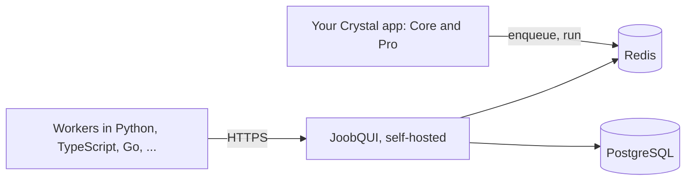

# Introduction

JoobQ runs background jobs for Crystal applications on the Redis you already have. JoobQ Pro adds durable workflows and coordination on top of it, and JoobQUI is a self-hosted console and API that operates both, with workers in eight more languages.

## Who it is for

Teams that build in Crystal and want typed background jobs, retries and dead letters without running a separate broker. Add Pro when a business process has several steps, signals or compensation; add JoobQUI when people operate the queues in production.

## How the pieces fit

| Part | What it is | Label on pages |
| --- | --- | --- |
| JoobQ | The open-source `joobq` shard: jobs, queues, workers, retries, dead letters, scheduling | **Core** |
| JoobQ Pro | The `joobq_pro` shard: workflows, sagas, rate limits, batches, metrics | **Pro** |
| JoobQUI | The console, `/api/v1`, `/metrics` and the SDK gateway, run on your servers | **JoobQUI** |

Versions are stated once, on the [compatibility page](reference/compatibility.md). Features that are not shipped yet are labelled **Roadmap**, and ones that are shipped but still settling are labelled **Preview**.

## Where to go

- [Tutorials](tutorials/README.md): run your first job in five minutes, then your first workflow.
- [How-to Guides](how-to/README.md): one task each, from installing to running in production.
- [Reference](reference/README.md): configuration, commands, routes and APIs, as the code defines them.
- [Explanation](explanation/README.md): how JoobQ works and why; start with [Why JoobQ](explanation/why-joobq.md).
