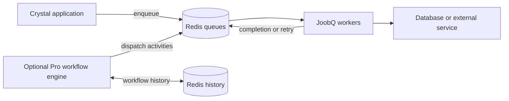

# Introduction

JoobQ moves work out of your request cycle and into Redis-backed queues. Write a typed Crystal job, enqueue it, and let a worker handle it. JoobQ Pro extends the same foundation with workflows, richer metrics, and explicit coordination services.

Use Core to send notifications, process orders, and schedule background work. Add Pro when that work needs dependencies, signals, compensation, or more detailed operational visibility. You do not need an Azu web application to use either shard.


Start with the [compatibility guide](introduction/compatibility.md). These docs teach released APIs first and label experimental paths. Redis persistence and application idempotency remain part of reliable operation.


## Start here

<table data-view="cards"><thead><tr><th></th><th></th><th data-hidden data-card-target data-type="content-ref"></th></tr></thead><tbody>
<tr><td><strong>Quick Start</strong></td><td>Run your first order-processing job.</td><td><a href="quick-start/README.md">Quick Start</a></td></tr>
<tr><td><strong>Core Concepts</strong></td><td>Understand queues, workers, retries, and dead letters.</td><td><a href="core/README.md">Core Concepts</a></td></tr>
<tr><td><strong>Pro Features</strong></td><td>Coordinate workflows and inspect their progress.</td><td><a href="pro/README.md">Pro Features</a></td></tr>
<tr><td><strong>Configuration</strong></td><td>Connect Redis and size your workers.</td><td><a href="configuration/README.md">Configuration</a></td></tr>
<tr><td><strong>Best Practices</strong></td><td>Design repeatable work and rehearse recovery.</td><td><a href="best-practices/README.md">Best Practices</a></td></tr>
</tbody></table>

## How the pieces fit

Crystal compiles job handlers to native code and uses fibers to overlap waiting work. Redis coordinates producers and workers. Actual throughput depends on your jobs, persistence, network, and concurrency; see [capacity planning](best-practices/performance.md) for a measurement method rather than a universal speed claim.

## Core and Pro, together

| Need | Where to start |
| --- | --- |
| Typed jobs, queues, retries, scheduling, and DLQ inspection | [Core](core/README.md) |
| Worker shutdown, TLS connections, and management tokens | [Configuration](configuration/README.md); these are not Pro-only |
| Typed sequential/parallel workflows, signals, timers, and compensation | [Pro workflow DSL](pro/workflow-dsl/README.md), since v0.2.2 |
| Durable batch membership and unique admission | [Pro coordination](pro/coordination.md); uses opt-in Delivery |
| Percentiles and alert evaluation | [Pro observability](pro/observability.md) |
| Terminal queue inspection | [CLI management](pro/management.md); Core works too |

[Screenshot: Azu CLI running azu joobq with the orders queue selected, waiting and processing counts, worker heartbeats, and a clearly labeled unavailable workflow provider when Pro is not loaded.]

**Next:** [Run your first job](quick-start/README.md), or [add Pro to an existing app](introduction/adding-pro.md).
