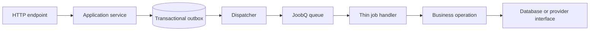

# Application architecture

A job should deserialize a small input, call a business operation, and let the queue's failure boundary handle the outcome. Avoid hiding server startup, connection setup, or broad exception swallowing inside `perform`.

## Keep responsibilities clear

- **Initializer:** registers job types, queues, middleware, and connection settings.
- **Producer:** validates business input and admits work with a stable identity.
- **Handler:** loads current state, invokes one operation, and reports failure accurately.
- **Service:** owns business rules and idempotency; test it without Redis.
- **Worker entry point:** starts and stops background services.

Pass record IDs and explicit versioned inputs. Avoid serializing connection objects, passwords, access tokens, or a full application model into a job. When changing fields, keep consumers compatible with old queued payloads until those jobs have drained or been migrated.

Use Pro workflows when orchestration needs durable state between steps, rather than growing one handler into a long sequence of hidden dependencies. Activity code remains an adapter around the same business services.

## Test at the right boundary

Unit-test business decisions. Integration-test serialized jobs with real Redis. Exercise the exact startup file used in deployment so missing queue registrations, license configuration, and dependency drift surface before release.
