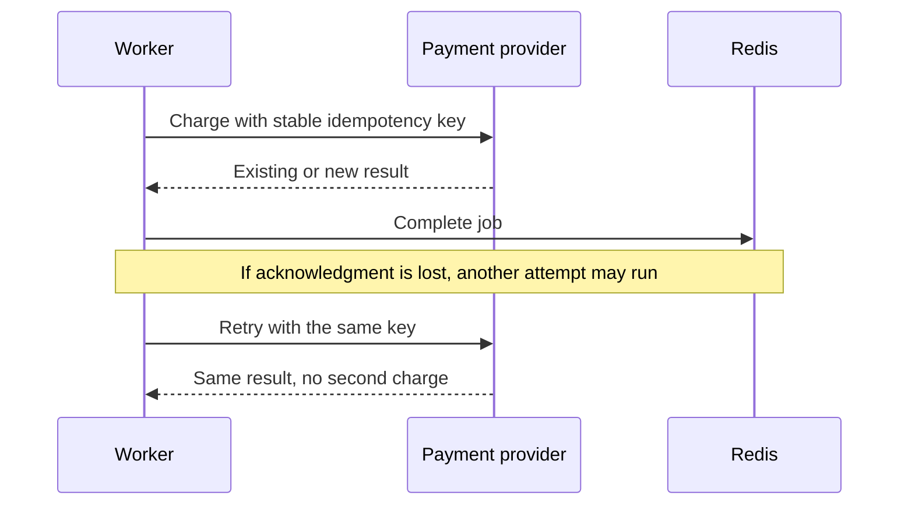

# Write idempotent jobs

A job can finish its external operation and lose its completion acknowledgment. When it runs again, it must recognize the same business action.

Use a key such as `order:42:receipt:v1`, derived from the operation, not a new random value generated on every attempt. The external provider or your application database must enforce that key atomically.

## Persist the decision and the effect

For database-only work, enforce a unique operation key and write the business result in the same transaction. For a database change that must enqueue work, use a transactional outbox and a retryable dispatcher. A database commit and a Redis enqueue are separate commits unless you build that coordination.

For HTTP effects, use the provider's idempotency API and persist its result. A local “already sent” check followed by a remote call still has a crash window. If the provider has no deduplication mechanism, document the remaining risk and add reconciliation.

## Keep identity through replay

Legacy jobs have a job ID, Delivery has receipts and context identity, and workflows have activity deduplication keys. Choose a business key that survives the replay paths you actually support. Re-enqueueing a job with a new job ID must not authorize a second payment.

Uniqueness and workflow leases reduce competing work; they do not commit your external transaction for you. Keep callback handlers and compensation steps idempotent too.
