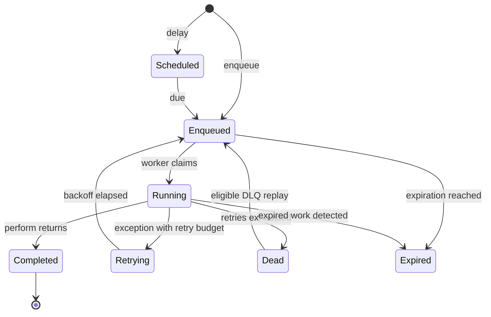

# Core Concepts

A **job** is a serializable unit of work. A **queue** holds jobs for a configured job type. **Workers** claim work from that queue and run `perform`. Redis stores queued and processing payloads; the worker applies the result through JoobQ's processing APIs.

## The standard job lifecycle

These names follow `JoobQ::Job::Status`. **DLQ** names the dead-letter store, not a separate enum value. Retry and expiry handling also update Redis structures; the diagram is a conceptual lifecycle, not an audit stream of every internal write. A running side effect cannot be undone just by changing its job status.

## Choose the right guide

- [Queues and workers](queues-workers.md): registration, capacity, and process ownership.
- [Retries and dead letters](retries-dlq.md): retry budget, backoff, and safe replay.
- [Scheduling](scheduling.md): delayed jobs and recurring work.
- [Delivery](delivery.md): a separate, opt-in leased API with receipts.

Use [Pro workflows](../pro/workflows.md) when the unit of work is a graph of dependent activities rather than one `perform` call. The same idempotency rules still apply.
