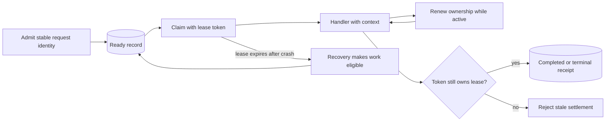

# Opt-in Delivery


**Preview:** `JoobQ::Delivery` is present in the documented source baselines but remains a separate opt-in processing path. Its presence does not declare a production migration complete. `Job.enqueue`, ordinary workers, and Core scheduling do not automatically use it.


Delivery assigns a persistent request identity, claims work with an expiring lease, and verifies ownership when settling the outcome. A runtime owns handlers, capacity, renewal, and drain behavior. A ledger stores admission and receipt state; a context exposes cancellation and an idempotency key.

A lease cannot revoke a network request that already reached an external service. Cancellation is cooperative; check the context and pass its stable idempotency key to the effect boundary. Keep receipts long enough to reconcile retries and delayed acknowledgements.

## Redis durability prerequisites

By default, the Delivery runtime checks `appendonly=yes`, `appendfsync=always`, and `maxmemory-policy=noeviction`. Its Redis identity needs permission to inspect those settings. A managed service that denies the configuration query needs an explicit operational design; do not disable the check merely to hide an unsupported deployment. These settings still do not prove a complete failover or backup guarantee.

## Plan a cutover

1. Inventory producers, consumers, delayed work, and existing processing lists.
2. Stop legacy admissions and drain or account for every outstanding legacy job.
3. Register Delivery handlers in an explicit namespace; confirm stable request IDs and payload compatibility.
4. Validate crashes, expired leases, reconciliation, and shutdown on an isolated workload.
5. Switch producers and consumers together. Record rollback boundaries before admitting real work.

Do not repoint both engines at the same structures. Core CLI queue metrics describe legacy processing unless an explicit Delivery provider says otherwise. Pro's durable batch/uniqueness services use this separate runtime; see [coordination](../pro/coordination.md).

The [Core design notes](https://github.com/azutoolkit/joobq/blob/v0.5.1/design/implementation-status.md) record the architectural boundary. Treat them as engineering context, not an activation command.
