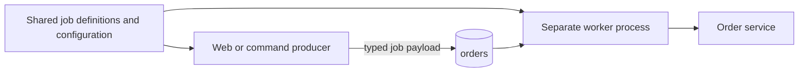

# Queues and workers

The [Quick Start](../quick-start/README.md) registers `ProcessOrderJob` on `orders` with two workers. The job's queue name must match. A process that boots successfully with no registered queues has nothing to consume.

## Registration is part of application boot

Define job types before configuring their queues. The typed `queue` DSL constructs a queue for that type; generated applications may instead register types with `QueueFactory` and populate `queue_configs`. Use the mechanism generated for your installed version rather than mixing partial examples from older guides.

Do not infer workers from Redis connectivity. A producer can connect and enqueue while no worker is alive. Inspect configured queues, heartbeat freshness, and completions together.

## Three different concurrency settings

| Setting | Controls | Does not prove |
| --- | --- | --- |
| Queue workers | Local worker loops for a queue | Cluster-wide concurrency |
| `worker_batch_size` | Maximum in-flight claims per legacy worker loop | A global cap across queues, processes, or fibers spawned by your handler |
| `CRYSTAL_WORKERS` | Crystal execution threads in a compatible multithreaded build | Number of JoobQ queue workers |

Each legacy worker spawns a fiber per claimed job. Two workers with the default batch size of ten can therefore hold up to twenty jobs in flight in that queue process. Setting two workers does not cap execution at two jobs. Workflow activity queues use this same legacy transport unless you explicitly configure Delivery.

Increase concurrency only while throughput improves without unacceptable latency, connection contention, or memory growth. Database and HTTP client pools must support the workload too. See [tuning](../configuration/concurrency.md).

## Producer and worker boundaries

Keep enqueueing in application services and execution in a supervised worker process. The shared boot file registers jobs and configuration; it should not start workers merely because a CLI inspector loads it.

**Next:** [Retries and dead letters](retries-dlq.md).


The typed queue DSL walkthrough targets standalone Core `v0.5.1`. Pro `v0.2.2` uses an earlier Core revision; register legacy job types with `QueueFactory` and `queue_configs` as shown in the [compatibility notes](../introduction/compatibility.md#release-specific-integration-notes).

