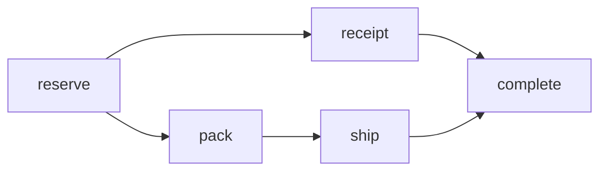

# Fan-out and join

Use `parallel` when independent work can overlap. Each branch waits for the preceding sequence. The next step waits for every branch under the engine's existing dependency-completion rules.

The [runnable parallel workflow](../pro/workflow-dsl/README.md) processes an order, then runs a receipt activity alongside a durable timer. For an ordered shipping branch, use `sequence`:

<!-- illustrative: inside a workflow after a reserve step, with application-defined activities -->
```crystal
parallel do
  step :receipt, SendReceipt, input: output(:reserve)

  sequence do
    step :pack, PackOrder
    step :ship, ShipOrder, input: output(:pack)
  end
end

step :complete, CompleteOrder
```



`complete` joins `receipt` and `ship`. Groups create dependency edges, not synthetic activities. Results are explicit: omitted activity input is the original workflow input, not the previous result.

Do not read an unfinished sibling's output. Add a dependency with `after:` or move the consumer after the block. A conditional skip can leave output unavailable, so design consumers for that case.

Parallel branches are eligible to run together; worker capacity and downstream limits determine actual concurrency. Avoid expanding unbounded input into thousands of steps during construction. For large workloads, choose bounded groups or the existing child-workflow API and measure history growth.

**Next:** [Sagas](sagas.md) and [concurrency tuning](../configuration/concurrency.md).
