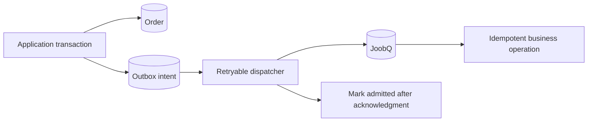

# Transactional outbox

An order commit and a Redis enqueue are two separate commits. If the process stops between them, the order can exist without its background work. An outbox keeps the intent to enqueue in the same database transaction as the order change.



## Store the intent with the change

This PostgreSQL fragment is application schema, not a built-in JoobQ table. Adapt the `orders` update to your schema; `$1` and `$2` are bound parameters.

```sql
CREATE TABLE job_outbox (
  operation_key text PRIMARY KEY,
  payload jsonb NOT NULL,
  created_at timestamptz NOT NULL DEFAULT now(),
  admitted_at timestamptz
);

BEGIN;
UPDATE orders SET state = 'placed' WHERE id = $1;
INSERT INTO job_outbox (operation_key, payload)
VALUES ($2, jsonb_build_object('order_id', $1))
ON CONFLICT (operation_key) DO NOTHING;
COMMIT;
```

Use a versioned business key such as `order:42:receipt:v1`. Only reuse it for the same intended action. The database must enforce the key; a check followed by a separate insert is not enough.

## Dispatch with recovery in mind

1. Claim a bounded set of pending rows with database locking or a renewable ownership lease. Multiple dispatchers must not casually take the same row.
2. Enqueue the job, carrying the original business key in its payload.
3. Mark the row admitted only after acknowledgment. Acknowledge uncertainty explicitly if the connection breaks.
4. Reclaim abandoned outbox claims and retry with the same business identity.

A crash after enqueue but before marking the row can cause another enqueue. Legacy `Job.enqueue` does not make that window exactly once. The handler must deduplicate the external effect; opt-in Delivery has separate receipt/admission APIs and migration requirements.

JoobQ does not supply this application outbox dispatcher in the documented release. Implement and test the database adapter, claiming rules, retention, and reconciliation alongside your domain code.

**Next:** [Idempotent effects](../best-practices/idempotency.md) and [recovery](../production-deployment/redis-and-recovery.md).
