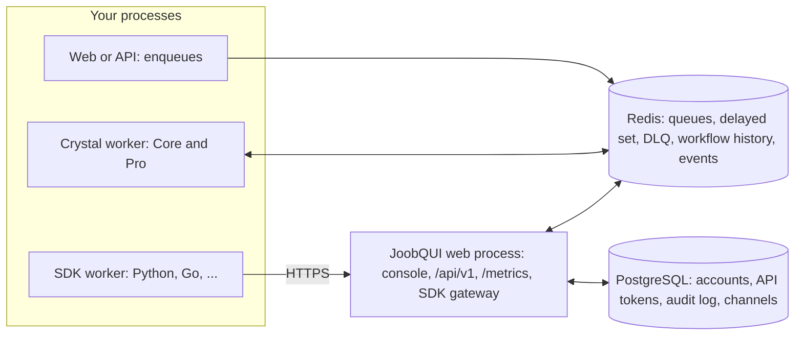

# Architecture at a glance

*Explanation · Core · Pro · JoobQUI*

Core and Pro are libraries inside your own processes; Redis holds every queue, delayed job, dead letter and workflow history. JoobQUI is one more process you run, beside your Redis and a PostgreSQL of its own, and workers in other languages reach it over HTTPS.

## When to use it

- **Plan a first deployment.** A web process that enqueues, a worker process that runs jobs, one Redis.
- **Add workers in another language.** A Python service runs jobs through JoobQUI's SDK gateway instead of talking to Redis.
- **Run the console with more than one replica.** Instances share state through Redis and PostgreSQL, and leader leases keep one of them on alerting and retention.

## How it works



A job is a thin adapter: `perform` reads its small input and calls a business operation you can test without Redis. Workflow activities are the same kind of adapter, called by Pro's engine. JoobQUI never loads or runs your code; it reads and changes the Redis state your workers use.

## Example

A job that only calls a business operation, with the operation checked before any worker starts:

<!-- example: core/thin_job.cr -->
```crystal
require "joobq"

# Application code; replace this formatter with your own business operation.
class ReceiptSummary
  def self.call(order_id : Int64, total_cents : Int32) : String
    raise ArgumentError.new("total must be non-negative") if total_cents < 0
    "Order #{order_id}: #{total_cents} cents"
  end
end

struct SummarizeReceiptJob
  include JoobQ::Job
  @queue = "receipts"
  getter order_id : Int64
  getter total_cents : Int32

  def initialize(@order_id : Int64, @total_cents : Int32)
  end

  def perform
    puts ReceiptSummary.call(order_id, total_cents)
  end
end

# The business operation can be checked without starting a worker.
raise "Unexpected receipt" unless ReceiptSummary.call(42_i64, 2500) == "Order 42: 2500 cents"
JoobQ.configure do |config|
  config.rest_api_enabled = false
  queue "receipts", 1, SummarizeReceiptJob
end
SummarizeReceiptJob.enqueue(order_id: 42_i64, total_cents: 2500)
JoobQ.forge
```

Output of `crystal run thin_job.cr` (log lines omitted):

```
Order 42: 2500 cents
```

## Options

| Component | Runs where | Keeps state in | Notes |
| --- | --- | --- | --- |
| Producer (web, API, script) | your process | Redis | Needs the job classes and the Redis settings, not a worker |
| Crystal worker | your process, `JoobQ.forge` | Redis | One or more processes per queue; SIGTERM drains them |
| Pro workflow worker | your process, `JoobQPro::Workflows::Worker` | Redis | Stop Pro (`JoobQPro.shutdown`) before Core (`JoobQ.shutdown`) |
| `joobqui-selfhosted` | your server or container | PostgreSQL and Redis | Console under `/ui/`, `/api/v1`, `/metrics`, the SDK gateway `/api/v1/sdk/*` |
| `joobqui-selfhosted --worker` | your server | Redis | Starts the configured queues and the YAML schedules; serves no HTTP |
| SDK worker | your process | none of its own | Polls the gateway with `JOOBQUI_SDK_TOKEN`; never needs Redis credentials |

JoobQUI instances elect a leader per role with a Redis lease (`joobqui:lease:alerts`, `joobqui:lease:retention`, 30 seconds by default; dead-letter retention takes its own short lease per pass) and release it on SIGTERM, so another instance takes over at once. Its container image checks `/joobq/health/check`.


**Production.** Redis holds the work: run it with persistence (AOF) and back it up; the opt-in Delivery runtime also refuses to start without `maxmemory-policy noeviction`. A managed Redis stores your queues; it does not run your Crystal code, and these releases coordinate through a single Redis, not Redis Cluster.



**JoobQUI.** Accounts, roles, API tokens and the audit log live in PostgreSQL, so they survive a Redis loss; queues, workflows and sessions' sign-out records live in Redis.


## Next steps

- [Deploy workers](../how-to/deploy-workers.md): run the worker process under a supervisor.
- [Polyglot SDKs and the gateway](https://joobq-website.onrender.com/docs/explanation/how-workers-run-your-code): how SDK workers reach JoobQUI.
- [Deploy self-hosted JoobQUI](https://joobq-website.onrender.com/docs/how-to/deploy-licensed-self-hosted).
