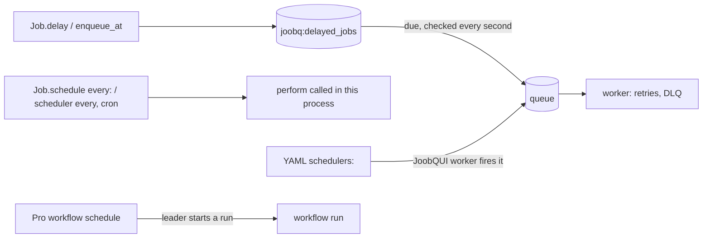

# Cron and recurring jobs

*Explanation · Core · Pro · JoobQUI*

JoobQ has four ways to run work later or on a schedule, and they differ in one thing that matters: whether the work goes through a queue, with its retries and dead letters. Core's recurring helpers call your code directly in the process that registered them; a delayed job, JoobQUI's schedules and Pro's workflow schedules go through queues.

## When to use it

- **Send a reminder in 24 hours.** One delayed job: `SendReminderJob.delay(for: 24.hours, ...)`.
- **Purge expired sessions every 10 minutes.** A recurring callback in one scheduler process that enqueues a job, so the job gets retries.
- **Close the books every night at 02:00 with overlap rules.** A Pro workflow schedule, with a time zone and an overlap policy.

## How it works



`Job.schedule(every:)` and the scheduler DSL's `every` and `cron` are loops in the process that registers them. They call `perform` (or your block) directly, starting at once for `every`: no queue, no retry, no dead letter, and two processes that register the same schedule both run it. Core loads the YAML `schedulers:` section but never fires it (`setup_schedulers_from_config` only logs "Would enqueue" at debug level, and `forge` does not call it); JoobQUI's worker process is what fires it.

## Example

<!-- example: core/recurring.cr -->
```crystal
require "joobq"

struct PurgeExpiredSessionsJob
  include JoobQ::Job

  @queue = "maintenance"
  @@runs = Atomic(Int32).new(0)

  def initialize
  end

  def self.runs
    @@runs.get
  end

  def perform
    @@runs.add(1)
    raise "session store unavailable"
  end
end

JoobQ.configure do |config|
  config.rest_api_enabled = false
  queue "maintenance", 1, PurgeExpiredSessionsJob
end

# `schedule(every:)` calls perform in this process: no queue, no retry, no dead letter.
PurgeExpiredSessionsJob.schedule(every: 500.milliseconds)
sleep 1200.milliseconds
JoobQ.shutdown(5.seconds)
puts "perform calls: #{PurgeExpiredSessionsJob.runs}"
puts "queued: #{JoobQ.store.queue_size("maintenance")}, dead letters: #{JoobQ::DeadLetterQueue.new.count("maintenance")}"
```

Output of `LOG_LEVEL=error crystal run recurring.cr`:

```
2026-11-06T01:39:44.287852Z  ERROR - Recurring job execution failed -- job: "PurgeExpiredSessionsJob", error_class: "Exception", error: "session store unavailable"
2026-11-06T01:39:44.787926Z  ERROR - Recurring job execution failed -- job: "PurgeExpiredSessionsJob", error_class: "Exception", error: "session store unavailable"
2026-11-06T01:39:45.288007Z  ERROR - Recurring job execution failed -- job: "PurgeExpiredSessionsJob", error_class: "Exception", error: "session store unavailable"
perform calls: 3
queued: 0, dead letters: 0
```

Every failure was only logged. To keep retries, make the recurring callback enqueue the real job, as `examples/docs/core/scheduled_jobs.cr` does.

## Options

| Parameter | Type | Default | Description |
| --- | --- | --- | --- |
| `Job.delay(for:, **args)`, `Job.enqueue_at(span, **args)` | `Time::Span` | none | One job, due after the span; both take a span, not a `Time` |
| `Job.schedule(every:, **args)` | `Time::Span` | none | Calls `perform` every span in this process, first call at once |
| `config.scheduler { every ...; cron "..." { } }` | DSL | none | Interval and cron loops in this process |
| `config.time_location` | `Time::Location` | `America/New_York` | Time zone of the scheduler DSL's cron patterns |
| YAML `schedulers:` | YAML | none | Loaded, never fired by Core; fired by `joobqui-selfhosted --worker` |
| Pro `overlap` | `OverlapPolicy` | `Skip` | `Skip`, `BufferOne`, `AllowAll` or `CancelPrevious` when the previous run is still open |
| Pro `catchup_window_ms` | `Int64` | `60000` | How late a missed fire time may still start |
| Pro `timezone` | `String` | `"UTC"` | Time zone of the workflow schedule |


**JoobQUI.** The Schedules page lists the YAML schedules; every `joobqui-selfhosted --worker` process runs them, and the first to claim a tick in Redis enqueues its job, so more workers never double a job. A paused schedule skips its ticks. Workflow schedules have their own page.


## Next steps

- [Schedule jobs](../how-to/schedule-jobs.md): delayed and recurring jobs, step by step.
- [Workflows and sagas](durable-workflows.md): what a workflow schedule starts.
- [Automate schedules and alerts](https://joobq-website.onrender.com/docs/tutorials/03-schedules-and-alerts): the console tutorial.
