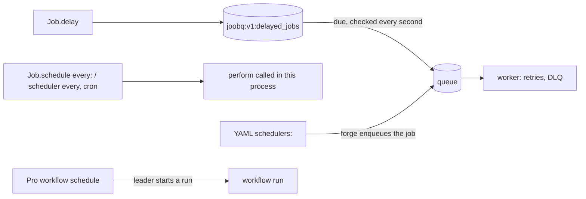

# Cron and recurring jobs

*Explanation · Core · Pro · JoobQUI*

JoobQ has four ways to run work later or on a schedule, and they differ in one thing that matters: whether the work goes through a queue, with its retries and dead letters. Core's recurring helpers call your code directly in the process that registered them; a delayed job, JoobQUI's schedules and Pro's workflow schedules go through queues.

## When to use it

- **Send a reminder in 24 hours.** One delayed job: `SendReminderJob.delay(for: 24.hours, ...)`.
- **Purge expired sessions every 10 minutes.** A recurring callback in one scheduler process that enqueues a job, so the job gets retries.
- **Close the books every night at 02:00 with overlap rules.** A Pro workflow schedule, with a time zone and an overlap policy.

## How it works



`Job.schedule(every:)` and the scheduler DSL's `every` and `cron` are loops in the process that registers them. They call `perform` (or your block) directly, starting at once for `every`: no queue, no retry, no dead letter, and two processes that register the same schedule both run it. The YAML `schedulers:` section is different: `forge` fires it (unless `fire_yaml_schedulers` is off), and each due `cron_jobs` or `recurring_jobs` entry **enqueues** a new job of its class onto the queue that serves that class, so it gets retries and dead letters like any other job. `args` are read as the job's JSON arguments, the way a stored job is read (its `initialize` does not run). `forge` refuses to start (`ConfigValidationError`) for an entry whose job is not registered with `QueueFactory.register_job_type`, whose `args` do not fit the job, or whose job no configured queue serves (or several do). Several processes may run `forge`, and one of them enqueues each run: a cron entry claims its minute in Redis (`SET NX` under `joobq:v1:schedule:`), a recurring one claims the right to enqueue for a little less than its interval, so no clocks have to agree. A process renews its own live claim and another is refused until it expires. The claim comes first, so a process that crashes between the claim and the enqueue loses that run (at most once per run); a failed enqueue gives back the process's own claim, and a process that cannot reach Redis skips the run. A refused claim still waits a full interval, so a process restarted inside an interval whose claim is alive can wait up to twice the interval once, and the enqueue in flight at shutdown may land just after `JoobQ.shutdown` returns. Cron patterns have a minute's resolution, so an entry fires at most once a minute. Entries of merged configuration files add up: an environment file that restates a base entry with other `args` gives two entries. Set `fire_yaml_schedulers: false` in a process whose host fires the entries itself.

## Example

<!-- example: core/recurring.cr -->
```crystal
require "joobq"

struct PurgeExpiredSessionsJob
  include JoobQ::Job

  @queue = "maintenance"
  @@runs = Atomic(Int32).new(0)

  def initialize
  end

  def self.runs
    @@runs.get
  end

  def perform
    @@runs.add(1)
    raise "session store unavailable"
  end
end

JoobQ.configure do |config|
  config.rest_api_enabled = false
  queue "maintenance", 1, PurgeExpiredSessionsJob
end

# `schedule(every:)` calls perform in this process: no queue, no retry, no dead letter.
PurgeExpiredSessionsJob.schedule(every: 500.milliseconds)
sleep 1200.milliseconds
JoobQ.shutdown(5.seconds)
puts "perform calls: #{PurgeExpiredSessionsJob.runs}"
puts "queued: #{JoobQ.store.queue_size("maintenance")}, dead letters: #{JoobQ::DeadLetterQueue.new.count("maintenance")}"
```

Output of `LOG_LEVEL=error crystal run recurring.cr`:

```
2026-11-06T01:39:44.287852Z  ERROR - Recurring job execution failed -- job: "PurgeExpiredSessionsJob", error_class: "Exception", error: "session store unavailable"
2026-11-06T01:39:44.787926Z  ERROR - Recurring job execution failed -- job: "PurgeExpiredSessionsJob", error_class: "Exception", error: "session store unavailable"
2026-11-06T01:39:45.288007Z  ERROR - Recurring job execution failed -- job: "PurgeExpiredSessionsJob", error_class: "Exception", error: "session store unavailable"
perform calls: 3
queued: 0, dead letters: 0
```

Every failure was only logged. To keep retries, make the recurring callback enqueue the real job, as `examples/docs/core/scheduled_jobs.cr` does.

## Options

| Parameter | Type | Default | Description |
| --- | --- | --- | --- |
| `Job.delay(for:, **args)` | `Time::Span` | none | One job, due after the span, not a `Time` (`Job.enqueue_at` is a deprecated alias) |
| `Job.schedule(every:, **args)` | `Time::Span` | none | Calls `perform` every span in this process, first call at once |
| `config.scheduler { every ...; cron "..." { } }` | DSL | none | Interval and cron loops in this process |
| `config.time_location` | `Time::Location` | `America/New_York` | Time zone of the scheduler DSL's cron patterns (set by YAML `timezone`); the process zone is not changed |
| YAML `schedulers:` | YAML | none | Parsed into `config.scheduler_configs`; `forge` fires each entry by enqueueing its job |
| `config.fire_yaml_schedulers` | `Bool` | `true` | `false` (or `settings.fire_yaml_schedulers: false`, `JOOBQ_FIRE_YAML_SCHEDULERS=false`) fires none and checks none; for a host that fires the entries itself, such as `joobqui-selfhosted` |
| Pro `overlap` | `OverlapPolicy` | `Skip` | `Skip`, `BufferOne`, `AllowAll` or `CancelPrevious` when the previous run is still open |
| Pro `catchup_window_ms` | `Int64` | `60000` | How late a missed fire time may still start |
| Pro `timezone` | `String` | `"UTC"` | Time zone of the workflow schedule |


**JoobQUI.** The Schedules page lists the YAML schedules; every `joobqui-selfhosted --worker` process runs them, and the first to claim a tick in Redis enqueues its job, so more workers never double a job. A paused schedule skips its ticks. Workflow schedules have their own page.


## Next steps

- [Schedule jobs](../how-to/schedule-jobs.md): delayed and recurring jobs, step by step.
- [Workflows and sagas](durable-workflows.md): what a workflow schedule starts.
- [Automate schedules and alerts](https://joobq-website.onrender.com/docs/tutorials/03-schedules-and-alerts): the console tutorial.
