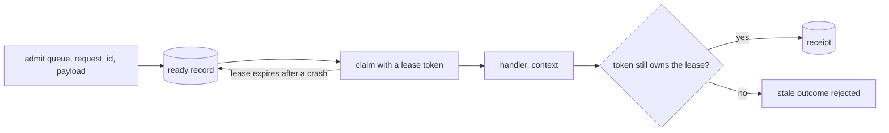

# Delivery

*Explanation · Core · Preview*

Delivery is a second, opt-in way for Core to run work: each request has a stable identity, a worker holds it under an expiring lease, and the outcome is settled only by the lease owner. Admitting the same request twice gives one execution, which ordinary `Job.enqueue` cannot promise.

## When to use it

- **Charge an invoice from a producer that may retry.** Admit `invoice-1001` as often as you like; it runs once.
- **Hand an external API a stable idempotency key.** `context.idempotency_key` stays the same when a crashed attempt is retried.
- **Build Pro's durable batches and unique jobs.** They need a Delivery runtime.

## How it works



A runtime owns its handlers, capacity and lease renewal; a ledger in Redis keeps admissions and receipts. When a process dies, its leases expire and the work becomes claimable again, so a handler can still run twice: pass the idempotency key to the system you call.

## Example

<!-- example: core/delivery.cr -->
```crystal
require "joobq"

JoobQ.configure { |config| config.rest_api_enabled = false }

# Checks appendonly=yes, appendfsync=always and maxmemory-policy=noeviction first.
runtime = JoobQ::Delivery::Runtime.new(JoobQ::RedisStore.instance, "billing", capacity: 2)
runtime.register("invoices") do |payload, context|
  puts "Charged invoice #{payload}, idempotency key #{context.idempotency_key}"
  JoobQ::Delivery::Outcome.new
end

first = runtime.admit("invoices", "invoice-1001", "1001")
again = runtime.admit("invoices", "invoice-1001", "1001")
puts "First admission: #{first.code}, same request again: #{again.code}, same id: #{first.id == again.id}"
runtime.start
sleep 1.second
puts "Drained cleanly: #{runtime.stop(5.seconds).clean}"
```

Output of `LOG_LEVEL=fatal crystal run delivery.cr` against a Redis with AOF `always` and `noeviction`:

```
First admission: Accepted, same request again: Accepted, same id: true
Charged invoice 1001, idempotency key 4a01e265a7f1c2180ff3afb4115fb3d03bf93c4d7b51bd1d383eee50ddde90e0
Drained cleanly: true
```

## Options

| Parameter | Type | Default | Description |
| --- | --- | --- | --- |
| `namespace` | `String` | none | Keeps one runtime's records apart from another's |
| `capacity` | `Int32` | `8` | Handlers running at once in this runtime, 1 to 1024 |
| `lease` | `Time::Span` | `30.seconds` | How long a claim is owned without renewal, 100 ms to 24 h |
| `execution_timeout` | `Time::Span` | `5.minutes` | Cooperative: the context reports cancellation, the fiber is not killed |
| `production` | `Bool` | `true` | Refuses to start unless Redis has `appendonly yes`, `appendfsync always`, `maxmemory-policy noeviction` |


**Preview.** `Job.enqueue`, ordinary workers and Core's schedulers do not use Delivery, and Delivery handlers never go through `config.middlewares` (retry, throttle, expiry, Pro's rate limit). Do not point both paths at the same work.



**Production.** The durability check needs `CONFIG GET` on your Redis; a managed service that denies it needs its own review before you turn the check off.


## Next steps

- [Batches and unique jobs](distributed-coordination.md): the Pro services built on Delivery.
- [Workers and concurrency](workers-and-concurrency.md): the ordinary queue path.
- [Set up Redis and recovery](../how-to/redis-and-recovery.md): configure AOF and eviction.
