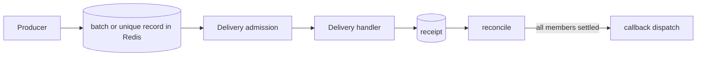

# Batches and unique jobs

*Explanation · Pro · Preview*

Pro's durable batches track a set of jobs until every member has a receipt, and unique admission refuses a second job for a key while the first holds it. Both are built on Core's opt-in Delivery runtime, so they only work with a `JoobQ::Delivery::Runtime` you start yourself.

## When to use it

- **Send one "export ready" email after 500 export jobs finish.** A batch with a completion callback.
- **Never generate the same invoice twice at once.** Unique admission on the key `invoice-42`.
- **Retry a producer safely.** Admitting again with the same request ID returns the first admission instead of a duplicate.

## How it works



A batch records its members before it is sealed, and reconciliation follows each member's Delivery receipt; callback dispatch is recoverable work, so a callback can run more than once. A unique record holds a key, an owner token and an expiry: a different request for a held key is answered `Duplicate`, and only the owner token can release it.

## Example

<!-- example: pro/coordination.cr -->
```crystal
require "joobq_pro"

JoobQ.configure { |config| config.rest_api_enabled = false }
store = JoobQ::RedisStore.instance
runtime = JoobQ::Delivery::Runtime.new(store, "docs-#{UUID.random}", capacity: 2, repair_every: 20.milliseconds)
runtime.register("orders") { |_, context| context.check!; JoobQ::Delivery::Outcome.new }
batches = JoobQPro::Durable::Batches.new(runtime)
unique = JoobQPro::Durable::UniqueJobs.new(runtime)

begin
  batch = batches.create(description: "Documentation batch")
  batches.add(batch.id, "orders", "order-42", "42")
  batches.seal(batch.id)

  admitted = unique.admit("orders", "invoice-42", "request-42", "42", mode: JoobQPro::UniquenessMode::WhileLocked)
  raise "Unique admission failed" unless admitted.code.accepted?
  duplicate = unique.admit("orders", "invoice-42", "request-43", "42", mode: JoobQPro::UniquenessMode::WhileLocked)
  raise "Duplicate was admitted" unless duplicate.code.duplicate?
  raise "Stale owner released reservation" if unique.release("orders", "invoice-42", "wrong-owner")

  runtime.start
  deadline = Time.instant + 10.seconds
  until batches.snapshot(batch.id).complete?
    raise "Batch did not complete" if Time.instant >= deadline
    sleep 20.milliseconds
  end
  raise "Batch did not record completion" unless batches.snapshot(batch.id).completed == 1
  owner = admitted.owner || raise "Missing unique owner"
  raise "Owner could not release reservation" unless unique.release("orders", "invoice-42", owner)

  limit = JoobQPro::RateLimit.new(count: 2, period: 1.minute)
  key = "docs-#{UUID.random}"
  results = Channel(Bool).new(8)
  8.times do
    spawn { results.send(JoobQPro::RateLimiter.reserve(key, limit, store.redis).allowed) }
  end
  permitted = 0
  8.times do
    select
    when allowed = results.receive
      permitted += 1 if allowed
    when timeout(5.seconds)
      raise "Rate reservation timed out"
    end
  end
  raise "Shared limit exceeded" unless permitted == 2
ensure
  drained = runtime.stop(5.seconds).clean
  JoobQPro.shutdown
  JoobQ.shutdown
  raise "Delivery did not drain" unless drained
end
puts "PASS batch uniqueness concurrent rate limit"
```

Output of `LOG_LEVEL=fatal crystal run coordination.cr` (run with the Pro fixtures; not executed in CI):

```
PASS batch uniqueness concurrent rate limit
```

The program creates and seals a one-member batch, admits `invoice-42` once and is refused the second time, checks that a wrong owner cannot release it, waits for the batch to complete, and lets eight fibers race for a limit of two rate permits.

## Options

| Parameter | Type | Default | Description |
| --- | --- | --- | --- |
| `Durable::Batches.new(runtime)` | `JoobQ::Delivery::Runtime` | none | Batches need an explicit Delivery runtime |
| `create(id, description, callbacks)` | `String`, `String`, `Hash` | random id, `""`, none | Opens a batch; `add` members, then `seal` |
| `Durable::UniqueJobs#admit(queue, key, request_id, payload, duration:, mode:)` | | `duration: 1.hour`, `mode: UntilExecuting` | `duration` 1 ms to 365 days; `request_id` 1 to 512 bytes |
| `UniquenessMode` | enum | `UntilExecuting` | `UntilExecuting`, `UntilExecuted` or `WhileLocked` |
| result `code` | `UniqueCode` | | `accepted?`, `duplicate?`; a Redis error gives `Unknown`, not acceptance |


**Preview.** These services ride on Delivery, a separate processing path that `Job.enqueue` and ordinary queue workers do not use. A unique key with a short duration is not permanent duplicate protection, and neither service makes an external payment or email happen exactly once.



## Next steps

- [Delivery](delivery.md): the runtime these services need.
- [Rate limiting and throttling](rate-limiting-and-throttling.md): the third coordination service.
- [Write idempotent jobs](../how-to/write-idempotent-jobs.md): protect the effect itself.
