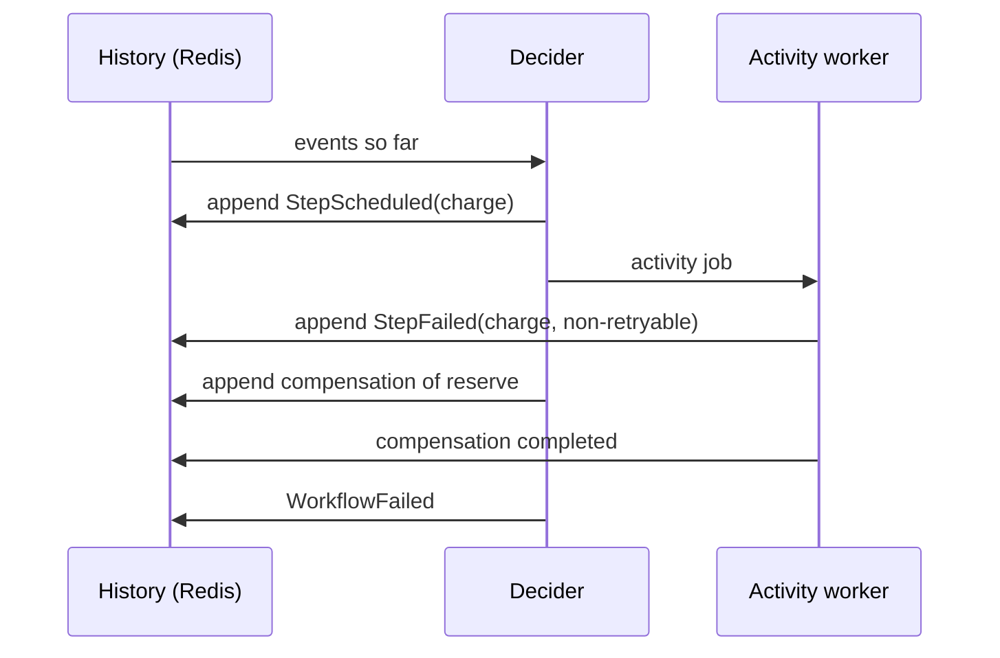

# Workflows and sagas

*Explanation · Pro*

A Pro workflow is a graph of steps whose progress is an append-only history in Redis, so a run survives worker restarts and can wait hours for a signal without holding a fiber. When a step fails for good, the engine runs the compensations of the steps that completed, newest first: the saga pattern.

## When to use it

- **Checkout across inventory, payments and shipping.** Reserve, charge, ship; a declined card releases the reservation.
- **Wait for a person.** A refund over a threshold waits for an `approve` signal, then continues.
- **Run independent steps at the same time and join.** Fraud check and address check in `parallel`, then charge once both finish.

## How it works



Every transition is a numbered history event, and the run's state is folded from those events. Steps run one after another unless you group them with `parallel`; `after:` adds explicit dependencies. Fan-out is static: the graph is fixed when the workflow is defined, and a `for_each` over a runtime list is **Roadmap**.

## Example

<!-- example: pro/compensation_workflow.cr -->
```crystal
require "joobq_pro"
include JoobQPro::Workflows::DSL

# A visible test effect, not a durable inventory database.
module DemoInventory
  RELEASED = Atomic(Bool).new(false)
end

class ReserveInventory
  def perform(order_id : Int64, context : JoobQPro::Workflows::ActivityContext) : Int64
    order_id
  end
end

class ReleaseInventory
  def perform(reservation_id : Int64, context : JoobQPro::Workflows::ActivityContext) : Int64
    DemoInventory::RELEASED.set(true)
    reservation_id
  end
end

class DeclinePayment
  def perform(order_id : Int64, context : JoobQPro::Workflows::ActivityContext) : String
    raise JoobQPro::Workflows::NonRetryableError.new("Card declined")
  end
end

Checkout = workflow "compensated-checkout", timeout: 1.minute do
  step :reserve, ReserveInventory,
    compensate: compensation(ReleaseInventory, input: output(:reserve))
  step :charge, DeclinePayment
end

JoobQ.configure { |config| config.rest_api_enabled = false }
worker = JoobQPro::Workflows::Worker.new(activity_workers: 1, orchestrators: 1, scheduler: false)
begin
  worker.register(Checkout).start
  id = worker.client.start("compensated-checkout", 42_i64)
  begin
    worker.client.result(id, timeout: 10.seconds)
    raise "Expected payment failure"
  rescue error : JoobQPro::Workflows::WorkflowFailed
    raise "Unexpected failure" unless error.failure.try(&.["message"].as_s) == "Card declined"
    raise "Reservation was not released" unless DemoInventory::RELEASED.get
    puts "PASS failed payment released its reservation"
  end
ensure
  JoobQPro.shutdown
  JoobQ.shutdown
end
```

Output of `crystal run compensation_workflow.cr` (run with the Pro fixtures; not executed in CI; log lines omitted):

```
PASS failed payment released its reservation
```

`DeclinePayment` raised a non-retryable error, so `charge` failed at once; the engine then ran `ReleaseInventory` with `reserve`'s output, and the run ended `WorkflowFailed` with the message "Card declined".

## Options

| Parameter | Type | Default | Description |
| --- | --- | --- | --- |
| `workflow name, version:, timeout:` | DSL | `version: 1`, no timeout | Defines a blueprint; register it with `worker.register(blueprint).start` |
| `step id, Activity, input:, after:, compensate:` | DSL | input is the workflow input | One activity; `compensate: compensation(Undo, input: output(:id))` |
| `parallel { }` / `sequence { }` | DSL | sequence | Concurrent branches / ordered steps inside a branch |
| `wait_for id, signal` / `timer id, for:` / `child id, workflow` | DSL | none | Wait for a signal, a duration or a child workflow |
| `scope id, timeout:, non_cancellable:` | DSL | cancellable | Cancel a group of steps as a unit, or shield cleanup from cancellation |
| `client.cancel(id)` / `client.terminate(id)` | method | | Cancel runs compensations, then ends `Cancelled`; terminate ends at once and undoes nothing |
| `ActivityContext#dedupe_key` | `String` | `workflow_id:step_id` | Same for every attempt of a step in a run; pass it to the services you call |


A compensation is another activity: it can fail or run twice, and it is not a database rollback. Give activities their own deadlines on the calls they make.



**JoobQUI.** The Workflows pages show a run's steps and history, and let an operator signal, cancel or terminate a run or retry a failed step. JoobQUI records each of these actions in its audit log.


## Next steps

- [Your first Pro workflow](../tutorials/first-pro-workflow.md): run one activity end to end.
- [Compensate with a saga](../how-to/sagas-and-compensation.md): add compensations to your workflow.
- [Workflow DSL](../reference/workflow-dsl.md): every DSL method.
