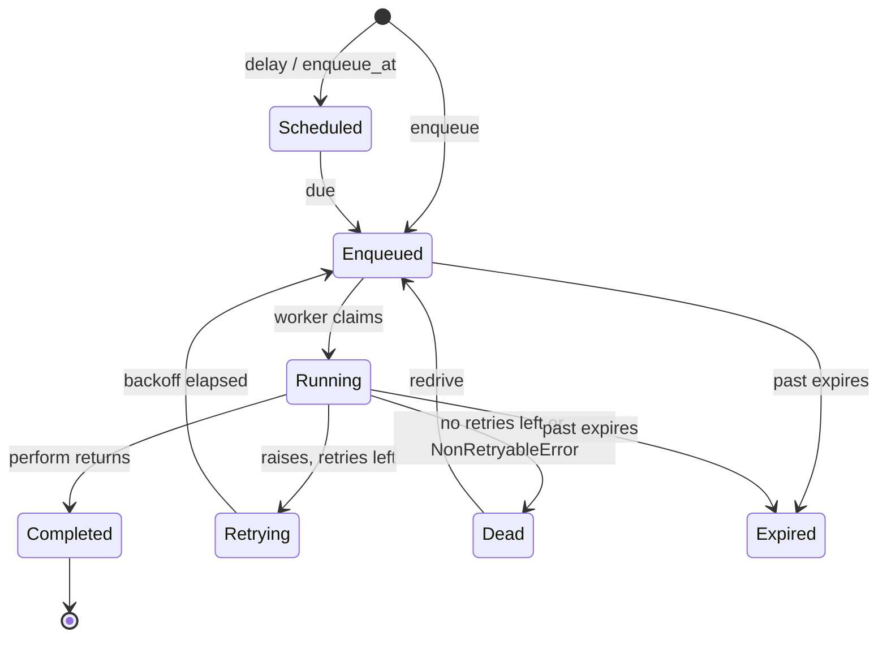

# Jobs and payloads

*Explanation · Core*

A job is a Crystal struct or class that includes `JoobQ::Job`: its properties are serialized to JSON, stored in Redis, and turned back into the struct by a worker that calls `perform`. Knowing what that JSON holds tells you what survives a restart and what a dead letter will show.

## When to use it

- **Send an email or call an API after a request returns.** The request enqueues `SendInvoiceEmailJob` and answers; a worker sends the email.
- **Keep a slow task off a web process.** Image resizing or report exports run in a separate worker process.
- **Survive a crash.** A job stored in Redis is still there when the process that enqueued it is gone.

## How it works



The states are the values of `JoobQ::Job::Status`. A job past its `expires` time is dead-lettered without running `perform`: by the worker that claims it, or by the reaper that scans waiting and processing jobs every 30 seconds (`reaper_interval`). A redrive puts a dead letter back on its queue with its full retry budget and a fresh `expires`.

## Example

<!-- example: core/invoice_job.cr -->
```crystal
require "joobq"

struct SendInvoiceEmailJob
  include JoobQ::Job

  @queue = "invoices"
  getter invoice_id : Int64
  getter email : String

  def initialize(@invoice_id : Int64, @email : String)
  end

  def perform
    puts "Sent invoice #{invoice_id} to #{email}"
  end
end

JoobQ.configure do |config|
  config.rest_api_enabled = false
  queue "invoices", 2, SendInvoiceEmailJob
end

SendInvoiceEmailJob.enqueue(invoice_id: 1001_i64, email: "ada@example.com")
stored = JSON.parse(JoobQ::RedisStore.instance.redis.lindex("invoices", 0).to_s)
puts "Stored fields: #{stored.as_h.keys.sort.join(", ")}"
puts "retries=#{stored["retries"]} status=#{stored["status"]}"
JoobQ.forge
```

Output of `crystal run invoice_job.cr` against a local Redis (log lines omitted):

```
Stored fields: email, error, expires, invoice_id, jid, max_retries, queue, retries, status
retries=3 status=enqueued
Sent invoice 1001 to ada@example.com
```

Your own properties (`invoice_id`, `email`) sit next to the fields JoobQ adds. Pass identifiers and plain values: a worker loads the current record when it runs, and the payload stays small and readable.

## Options

| Parameter | Type | Default | Description |
| --- | --- | --- | --- |
| `jid` | `UUID` | random | The job's identity; Core has no other idempotency key |
| `queue` | `String` | `config.default_queue` (`"default"`) | The Redis list the job is pushed to |
| `retries` | `Int32` | `config.retries` (3) | Retries left; the retry middleware decrements it |
| `max_retries` | `Int32` | `config.retries` (3) | The budget the job started with |
| `expires` | `Int64` | now + `config.expires` (3 days) | Unix time in milliseconds after which the job is dead-lettered instead of run |
| `status` | `Status` | `Enqueued` | One of `Completed`, `Dead`, `Enqueued`, `Expired`, `Retrying`, `Running`, `Scheduled` |
| `error` | named tuple or `nil` | `nil` | The last failure, set when a run raises |


**JoobQUI.** The console's job pages read this stored JSON. Argument names that look secret (`password`, `token`, `auth`, ...) are masked there, and fields declared with `encrypted_property` are sealed before they reach Redis. See [Security model](https://joobq-website.onrender.com/docs/explanation/security-audit-and-redaction).



A job can run more than once: a worker can finish the work and die before it records the outcome. Core gives each job a `jid`, not an idempotency key; make the effect safe to repeat.


## Next steps

- [Queues and priorities](queues-and-workers.md): where the JSON goes and in which order it comes out.
- [Retries, backoff and the DLQ](retries-and-dead-letters.md): what `retries` and `error` do.
- [Write and enqueue jobs](../how-to/write-and-enqueue-jobs.md): the task, step by step.
