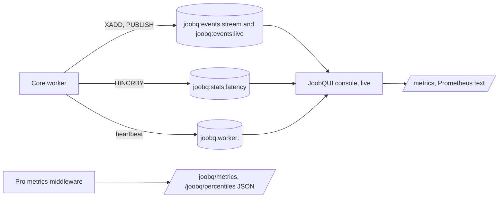

# Live observability and metrics

*Explanation · Core · Pro · JoobQUI*

Core records what happens in Redis: a latency histogram and counters always, and lifecycle events and worker heartbeats once your worker process turns them on. Pro adds in-process metrics, percentiles and alerts, and JoobQUI turns the Redis data into a live console and a Prometheus `/metrics` endpoint.

## When to use it

- **Alert when invoices back up.** Scrape `joobqui_queue_size{queue="invoices"}` from JoobQUI and alert on it.
- **Find the slow job class.** Core's latency histogram per queue, shown in the console and exported as `joobqui_job_duration_seconds`.
- **Follow one job across logs.** Core's `JoobQ::JSONLogFormatter` writes NDJSON with the job id, queue and worker in each record.

## How it works



Core emits lifecycle events (`job.enqueued`, `job.started`, `job.completed`, `job.retrying`, `job.dead`, `queue.paused`, ...); with `JoobQ::Events.subscribe(JoobQ::RedisEventSink.new)` in a process, its events go to a capped Redis stream and a live channel. Heartbeats need `JoobQ::WorkerRegistry.new.start` in the worker process; `forge` starts neither. Neither Core nor Pro serves Prometheus over HTTP; JoobQUI does, from what Core stores in Redis. Pro's metrics middleware adds JSON routes to Core's management API.

## Example

Reading JoobQUI's `/metrics` with an API token, after one job ran on `invoices`:

```sh
curl -s -H "Authorization: Bearer $JOOBQUI_TOKEN" http://127.0.0.1:4810/metrics \
  | grep -E "^joobqui_(queue_|workers_registered|leader|jobs_processed)"
```

```
joobqui_queue_size{queue="invoices"} 0
joobqui_queue_processing{queue="invoices"} 0
joobqui_queue_dead{queue="invoices"} 0
joobqui_queue_paused{queue="invoices"} 0
joobqui_queue_concurrency{queue="invoices"} 0
joobqui_jobs_processed_total{queue="invoices"} 1
joobqui_workers_registered 0
joobqui_leader{role="alerts"} 1
joobqui_leader{role="retention"} 1
```

Without a token the same request answers `401`. The job ran on an SDK worker, which reports through JoobQUI's gateway rather than Core's worker registry, so `joobqui_workers_registered` stays 0.

## Options

| Signal | Where | Kind | Description |
| --- | --- | --- | --- |
| Lifecycle events | `joobq:events`, `joobq:events:live` | Redis stream, pub/sub | Enqueue, start, completion, retry, dead letter, pause, resize; written by a subscribed `RedisEventSink` |
| Run time | `joobq:stats:latency` | Redis hash | Histogram buckets of `perform` time per queue |
| Worker heartbeat | `joobq:worker:<id>`, `joobq:workers` | Redis key with a 30 s TTL, sorted set | Every 10 s from `JoobQ::WorkerRegistry#start`: host, pid, queues, concurrency, active fibers, RSS, CPU |
| Structured logs | `JoobQ::JSONLogFormatter` | `Log::Formatter` | Opt-in NDJSON: timestamp, severity, source, message, pid, data, context |
| Pro metrics | `JoobQPro::Middleware::Metrics.instance` | middleware | Counters and percentiles; `/joobq/metrics`, `/joobq/percentiles`, `/joobq/alerts` on Core's management API |
| JoobQUI `/metrics` | JoobQUI web process | Prometheus text 0.0.4 | Queue gauges, processed counters, job duration histogram, workflows by status, API request counters, leader leases, build info |


**JoobQUI.** `/metrics` needs a viewer role or above (an API token from the console, or a session). The console's Workers page shows per-process RSS and CPU from the heartbeat; it does not collect host metrics.



Pro's `WebhookAlertHandler` only logs that it would send a webhook. For alert notifications to Slack, email, PagerDuty or a signed webhook, use JoobQUI's alert rules and channels.


## Next steps

- [Measure performance](../how-to/measure-performance.md): measure your own workload.
- [Security model](https://joobq-website.onrender.com/docs/explanation/security-audit-and-redaction): who can read `/metrics` and the stream.
- [HTTP API, WebSockets, metrics and webhooks](https://joobq-website.onrender.com/docs/reference/api-and-webhooks): every route.
