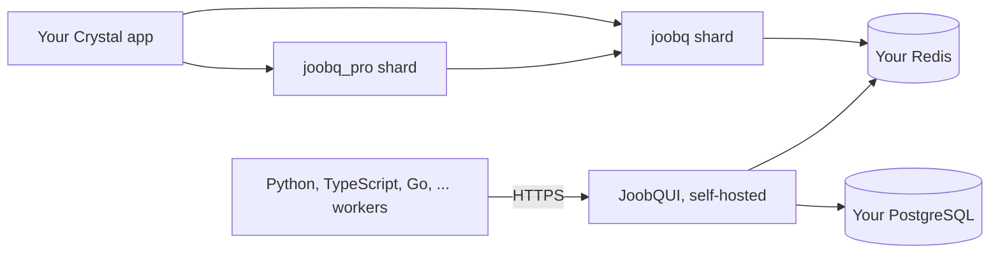

# Open Source vs Pro vs JoobQUI

*Explanation · Core · Pro · JoobQUI*

JoobQ comes in three layers that stack: the open-source `joobq` shard runs jobs, the `joobq_pro` shard adds durable workflows and coordination on top of it, and JoobQUI is a self-hosted console and API that operates both. You can start with Core alone and add the others without rewriting your jobs.

## When to use it

- **A single app with background emails and exports.** Core is enough: typed jobs, retries, dead letters, throttling, expiry.
- **Multi-step business processes.** Add Pro when a checkout or onboarding needs steps, signals, timers and compensation.
- **A team that operates queues in production.** Add JoobQUI for a console with roles, audit, alerts, `/metrics`, and workers in eight more languages.

## How it works



Pro requires Core (`joobq >= 0.5.6, < 0.6.0` for Pro 0.2.4) and uses the same Redis. JoobQUI reads and writes the same Redis keys as your workers, and keeps accounts, tokens and the audit log in PostgreSQL.

## Example

The two shard entries, as the documentation fixtures pin them:

```yaml
# Core only
dependencies:
  joobq:
    github: azutoolkit/joobq
    version: "= 0.5.6"
```

```yaml
# Pro (a private repository: you need read access); it brings joobq with it
dependencies:
  joobq_pro:
    github: azutoolkit/joobq-pro
    version: "= 0.2.4"
```

A Pro program without `JOOBQ_PRO_LICENSE` still runs (with `CRYSTAL_ENV` or `JOOBQ_ENV` set to `development` or `test`, Pro treats itself as licensed and prints no warning). Output of `LOG_LEVEL=warn crystal run first_workflow.cr` with no licence key:

```
2026-11-06T01:27:09.734679Z   WARN - joobq_pro.license: No license key found. Set JOOBQ_PRO_LICENSE environment variable.
2026-11-06T01:27:09.734692Z   WARN - joobq_pro.license: Purchase a license at https://joobq.dev/pricing
2026-11-06T01:27:09.734703Z   WARN - joobq_pro.license: ======================================================================
2026-11-06T01:27:09.734704Z   WARN - joobq_pro.license: JoobQ Pro is running without a valid license.
2026-11-06T01:27:09.734704Z   WARN - joobq_pro.license: Pro features will work but this is not licensed for production use.
2026-11-06T01:27:09.734705Z   WARN - joobq_pro.license: Purchase a license at https://joobq.dev/pricing
2026-11-06T01:27:09.734705Z   WARN - joobq_pro.license: ======================================================================
Processed order 42
```

## Options

| Capability | Core | Pro | JoobQUI |
| --- | --- | --- | --- |
| Typed jobs, Redis queues, workers, retries, DLQ, redrive | yes | yes (Core's) | operate them: pause, resize, redrive, purge, export |
| Delayed, recurring and cron jobs | process-local | + workflow schedules | fires YAML `schedulers:`; manages workflow schedules |
| Throttle per queue, job expiry | yes | yes (Core's) | |
| Cross-process rate limit, durable batches, unique jobs | | yes | |
| Durable workflows, sagas, signals, timers, build ids | | yes | inspect and act on runs |
| Worker languages | Crystal | Crystal | + Python, TypeScript, Ruby, Go, Rust, Java, PHP, .NET through the SDK gateway |
| Prometheus `/metrics`, roles, API tokens, audit log, TOTP, OIDC | | | yes |
| HTTP management API | `/joobq/*`, bearer tokens, off by default | + JSON metrics routes | `/api/v1`, described at `/api/v1/openapi.json` |

The full, row-by-row list is the [feature matrix](../reference/compatibility.md).


**Pro licensing is soft today.** Without a valid `JOOBQ_PRO_LICENSE`, Pro logs the warning above and every feature still works. The licence knows two paid tiers, Pro and Enterprise (plus Trial); workflows (`workflow_engine`) and `alerting` are Enterprise features, but no code path refuses them.



**JoobQUI** is sold as self-hosted software that you run next to your Redis and PostgreSQL. The JoobQ portal (app.joobq.io) is where you buy the licence and get the licence token you set as `JOOBQUI_LICENSE`: see [Get a licence and connect your deployment](../how-to/README.md#production-ops).


## Next steps

- [Why JoobQ](why-joobq.md): what each layer is good at.
- [Add Pro to an existing application](../how-to/add-pro.md).
- [Deploy self-hosted JoobQUI](https://joobq-website.onrender.com/docs/how-to/deploy-licensed-self-hosted).
