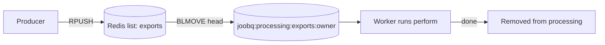

# Queues and priorities

*Explanation · Core*

A JoobQ queue is a Redis list for one job type, served by a fixed number of workers. Core has no priority field: urgent work goes on a queue of its own with enough workers, so a backlog of slow jobs never holds it up.

## When to use it

- **Keep password-reset emails fast while newsletters pile up.** `emails-urgent` gets four workers, `emails-bulk` one.
- **Isolate a fragile dependency.** Jobs that call a slow partner API get their own queue, so their backlog does not delay invoices.
- **Give one tenant or region its own capacity.** A queue per group, with workers sized to each.

## How it works



`enqueue` appends the job's JSON to the tail of the list (`RPUSH`); a worker claims the job at the head into its own processing list (`BLMOVE … LEFT LEFT`, which needs Redis 6.2 or newer). The oldest waiting job therefore runs first: the order is first in, first out. With several workers, or a batch above one, jobs claimed together run at the same time, so completion order is not guaranteed; if you need a strict sequence, put an ordering key in the payload and check it in `perform`.

## Example

<!-- example: core/queue_order.cr -->
```crystal
require "joobq"

struct ExportReportJob
  include JoobQ::Job

  @queue = "exports"
  getter report_id : Int32

  def initialize(@report_id : Int32)
  end

  def perform
    puts "Exported report #{report_id}"
  end
end

JoobQ.configure do |config|
  config.rest_api_enabled = false
  config.worker_batch_size = 1
  queue "exports", 1, ExportReportJob
end

# Enqueued before any worker runs: 1, then 2, then 3.
(1..3).each { |id| ExportReportJob.enqueue(report_id: id) }
JoobQ.forge
```

Output of `crystal run queue_order.cr` (log lines omitted):

```
Exported report 1
Exported report 2
Exported report 3
```

With one worker that claims one job at a time, the three jobs run in the order they were enqueued. With more workers or a larger batch they run at the same time, and no order holds.

## Options

| Parameter | Type | Default | Description |
| --- | --- | --- | --- |
| `queue name, workers, JobClass` | `queue` macro arguments | none | One queue for one job type; `workers` must be 1 to 1000 |
| `throttle` | `{limit: Int32, period: Time::Span}` | `nil` | Optional fourth argument: starts spaced at least `period / limit` apart, per queue, in this process |
| `@queue` | `String` | `"default"` | Set in the job; it must match a configured queue name |
| `default_queue` | `String` | `"default"` | The queue a job uses when it sets none |

A worker only runs the type its queue was declared with, so one job type per queue. A paused queue keeps its jobs; its workers stop claiming until it is resumed.


**JoobQUI.** The console lists every queue with its size, processing count, dead letters, pause state and worker count, and `/metrics` exports the same numbers per queue (`joobqui_queue_size`, `joobqui_queue_processing`, ...). Watch the urgent queue's size: it is your priority signal.



The deprecated `POST /joobq/jobs` route validates a `priority` field (0 to 100) but nothing reads it. Do not rely on it.


## Next steps

- [Workers and concurrency](workers-and-concurrency.md): how many jobs a queue runs at once.
- [Configure queues](../how-to/configure-queues.md): set up the queues for your job types.
- [Rate limiting and throttling](rate-limiting-and-throttling.md): the `throttle` argument and Pro's rate limiter.
