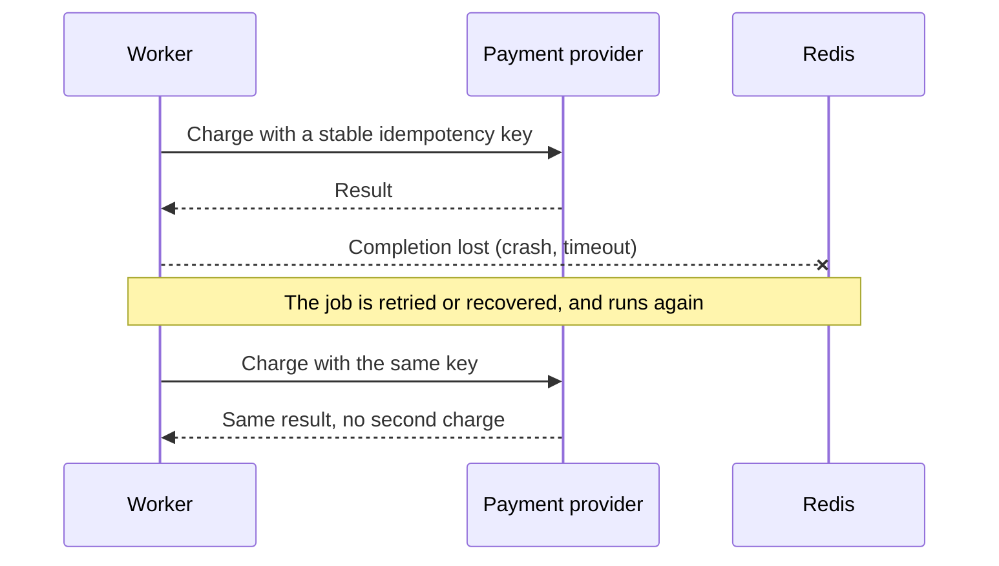

# Reliability and recovery

*Explanation · Core · Pro*

Background work fails in the gaps: a worker finishes a payment and dies before recording it, a database commits and the enqueue after it never happens, a restart recovers less than you expected. Knowing those gaps tells you where your own code has to make a repeat harmless.

## When to use it

- **Charge a card from a job.** The charge may succeed and its acknowledgement be lost, so the next attempt must recognise it.
- **Enqueue after a database write.** The order commits and the process stops before `enqueue`: an outbox row in the same transaction closes that gap.
- **Plan recovery.** Decide how much acknowledged work you can lose and how long recovery may take, then test the Redis setup against it.

## How it works



Every path can repeat: retries, shutdown requeues, lease expiry in Delivery and the SDK gateway, workflow activity retries. A job's `jid` changes when you enqueue the same work again, so the key that stops a duplicate effect has to come from the business operation (`order:42:receipt:v1`) and be enforced where the effect happens: a unique constraint, or the provider's idempotency API. A local "already sent?" check before a remote call still has a crash window between the two.

Some failures have an unknown outcome: Redis may accept a write and the reply never arrive. Treat that as "maybe", reconcile with the identity you kept, and do not enqueue again with a new identity.

A database commit and a Redis enqueue are two commits. An outbox keeps the intent to enqueue in the same transaction as the change; a dispatcher enqueues it and marks it admitted, and because it can enqueue twice after a crash, the handler still has to deduplicate. JoobQ supplies no outbox dispatcher.

From 0.6, each process claims into its own processing list (`joobq:processing:<queue>:<owner>`) and publishes a heartbeat. On restart, in the reaper, and on demand (`Queue#start`, the expired-job reaper, `POST /joobq/queues/:name/reprocess`), a Core queue returns **every** job of a crashed or stopped process from its processing list back to the head of the queue, in claim order. A process's list is reclaimed only once its heartbeat has lapsed, so a consumer starting beside live workers never moves their in-flight jobs. A clean SIGTERM still returns its own unfinished jobs to the head first; after a SIGKILL, the heartbeat lapses and recovery reclaims the jobs within the TTL. (Before 0.6, startup moved at most one job, with no owner check.)

Redis persistence (AOF, RDB, replicas, backups) decides how much acknowledged work survives a failure. An eviction policy other than `noeviction` can silently drop queue keys when memory runs out.

What a process signal can and cannot do matters in deployment: a SIGKILL, a Redis outage or a supervisor that gives up too early prevents the final hand-back of unfinished jobs, and `JoobQ.shutdown`'s `Bool` says only whether this call did the shutdown, not whether every job drained (read `JoobQ.abandoned_jobs`); `JoobQPro.shutdown` does return whether its services stopped within the timeout. A "worker ready" log line or a running Pod shows that the process started, not that jobs complete: only a canary job or run checks admission, dispatch and completion. A Redis `PING` does not exercise the Lua scripts, ACL rules or failover paths your features use.

Environment variables are read when the store is created; changing one later does not reconnect an existing pool.

A job's queue, retry budget and expiry are fixed when it is constructed, and its default expiry is three days from construction, not from a delayed start. Renaming or retyping a property can break jobs already waiting in Redis. `config.timeout` is validated but does not interrupt handler code: put deadlines on your HTTP and database clients.

When measuring, count completed jobs rather than admissions; larger batches lower command overhead but hold more work per worker, and more parallelism can exhaust database or HTTP pools.

## Example

Keep the business operation separate from the job, so it can be checked, and made idempotent, without Redis:

<!-- example: core/thin_job.cr -->
```crystal
require "joobq"

# Application code; replace this formatter with your own business operation.
class ReceiptSummary
  def self.call(order_id : Int64, total_cents : Int32) : String
    raise ArgumentError.new("total must be non-negative") if total_cents < 0
    "Order #{order_id}: #{total_cents} cents"
  end
end

struct SummarizeReceiptJob
  include JoobQ::Job
  @queue = "receipts"
  getter order_id : Int64
  getter total_cents : Int32

  def initialize(@order_id : Int64, @total_cents : Int32)
  end

  def perform
    puts ReceiptSummary.call(order_id, total_cents)
  end
end

# The business operation can be checked without starting a worker.
raise "Unexpected receipt" unless ReceiptSummary.call(42_i64, 2500) == "Order 42: 2500 cents"
JoobQ.configure do |config|
  config.rest_api_enabled = false
  queue "receipts", 1, SummarizeReceiptJob
end
SummarizeReceiptJob.enqueue(order_id: 42_i64, total_cents: 2500)
JoobQ.forge
```

Output of `crystal run thin_job.cr` (log lines omitted):

```
Order 42: 2500 cents
```

## Options

| Identity | Comes from | Stable across |
| --- | --- | --- |
| `jid` | `JoobQ::Job`, set at construction | retries and redrives of that job; not a new `enqueue` |
| Delivery `context.idempotency_key` | the admission's record id | redeliveries of that admission |
| `ActivityContext#dedupe_key` | `workflow_id:step_id` | attempts of a step in one run; not a new run |
| Pro unique admission key | your key | its `duration` (default one hour) |
| Your business key | your code | everything, if your store enforces it |


No shard can make an email or a payment happen exactly once. Retries, leases and uniqueness reduce competing work; the effect itself needs an idempotency key or a reconciliation step.



**JoobQUI.** A redrive from the console runs the job again with the same `jid` and a fresh retry budget: check whether the effect happened before you redrive.


## Next steps

- [Write idempotent jobs](../how-to/write-idempotent-jobs.md)
- [Enqueue from a transactional outbox](../how-to/transactional-outbox.md)
- [Recover and migrate](../how-to/recover-and-migrate.md)
