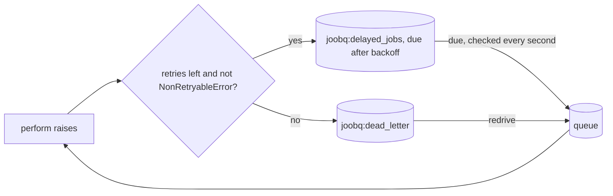

# Retries, backoff and the DLQ

*Explanation · Core*

A job that raises is retried with exponential backoff until its retry budget runs out; then it moves to the dead letter queue (DLQ) with the error that killed it. Transient failures heal on their own, and permanent ones wait for a person instead of looping.

## When to use it

- **Ride out a partner outage.** A CRM that answers 503 for a few seconds gets three more attempts, spaced 1, 2 and 4 seconds apart.
- **Stop at once on a permanent failure.** A declined card raises `JoobQ::NonRetryableError` and goes straight to the DLQ.
- **Repair and replay.** Fix the bug, then redrive the dead letters: they run again with a full budget.

## How it works



The delay before retry *n* (n = 0 for the first failure) is `min(2^n seconds, 1 hour)`, with no jitter; `n` is `max_retries - retries` at the time of the failure. The retry waits in a delayed set that is checked once a second, so an attempt starts up to about a second after its backoff. A retry lock (`joobq:retry_lock:<jid>`) makes sure one failure is scheduled once, even if two handlers see it.

## Example

<!-- example: core/retry_backoff.cr -->
```crystal
require "joobq"

STARTED = Time.instant

struct SyncCrmContactJob
  include JoobQ::Job

  @queue = "crm"
  getter contact_id : Int64

  def initialize(@contact_id : Int64)
  end

  def perform
    puts "Attempt #{max_retries - retries + 1} at #{(Time.instant - STARTED).total_seconds.round(1)}s"
    raise "CRM answered 503"
  end
end

struct ChargeCardJob
  include JoobQ::Job

  @queue = "payments"

  class Declined < JoobQ::NonRetryableError
  end

  def initialize
  end

  def perform
    puts "ChargeCardJob ran once"
    raise Declined.new("card declined")
  end
end

JoobQ.configure do |config|
  config.rest_api_enabled = false
  queue "crm", 1, SyncCrmContactJob
  queue "payments", 1, ChargeCardJob
end

dlq = JoobQ::DeadLetterQueue.new
spawn { JoobQ.forge(trap_signals: false) }
SyncCrmContactJob.enqueue(contact_id: 7_i64)
ChargeCardJob.enqueue
until dlq.count("crm") + dlq.count("payments") == 2
  sleep 100.milliseconds
end
JoobQ.shutdown(5.seconds)
(dlq.page(queue: "crm") + dlq.page(queue: "payments")).each { |entry| puts "Dead letter (#{entry.queue}): #{entry.error}" }
```

Output of `LOG_LEVEL=fatal crystal run retry_backoff.cr`:

```
Attempt 1 at 0.5s
ChargeCardJob ran once
Attempt 2 at 2.0s
Attempt 3 at 5.0s
Attempt 4 at 10.1s
Dead letter (crm): CRM answered 503
Dead letter (payments): card declined
```

The gaps are 1.5, 3.0 and 5.1 seconds: the 1, 2 and 4 second backoffs plus the wait for the next check of the delayed set. Four attempts is the first run plus the default three retries.

## Options

| Parameter | Type | Default | Description |
| --- | --- | --- | --- |
| `retries` | `Int32` | `3` | Retries after the first run, 0 to 100; set per job or with `config.retries` |
| backoff | fixed | `min(2^n s, 1 h)` | Not configurable in Core |
| `JoobQ::NonRetryableError` | exception class | none | Raise it, or a subclass, to dead-letter at once |
| `dead_letter_ttl` | `Time::Span` | `7.days` | Accepted and validated, but the Redis DLQ does not expire entries |

A dead letter keeps the job's JSON with an `error` object (a job that ran out of retries or raised `NonRetryableError` also has `"status": "dead"`): `error_class`, `error_type` (`non_retryable_error`, `validation_error`, `connection_error`, `unknown_error`, ...), `message` (at most 4 KiB), `backtrace` (first 20 lines, at most 8 KiB), `cause`, `failed_at`, `retry_count` and `system_context`. Values of `encrypted_property` fields are removed from the message and backtrace. A redrive clears the error and restores the job's `max_retries`.


The DLQ is a Redis sorted set that grows until you purge it: `dead_letter_ttl` is not enforced. Watch its size and decide how long you keep entries.



**JoobQUI.** The Dead letters page lists entries with their error, and lets an operator redrive, purge or export them. A redrive in the console uses the same Core redrive, so it also resets the retry budget.


## Next steps

- [Handle failures](../how-to/handle-failures.md): choose what to retry and what to stop.
- [Triage, redrive and export dead letters](https://joobq-website.onrender.com/docs/how-to/triage-and-redrive-dead-letters): the console workflow.
- [Jobs and payloads](job-lifecycle.md): the fields a dead letter keeps.
