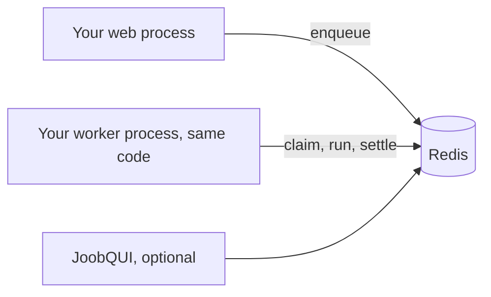

# Why JoobQ

*Explanation · Core · Pro · JoobQUI*

JoobQ is a job queue for Crystal applications that needs nothing but the Redis you already run, and grows into durable workflows and a self-hosted operations console when you need them. It suits small teams that want typed background jobs and production controls without operating a separate broker.

## When to use it

- **A Crystal web app that sends email, builds exports or calls webhooks.** Jobs are Crystal structs, checked by the compiler, stored as JSON in Redis.
- **A team of one to ten that operates its own servers.** One more process (the worker) and the Redis you have; no broker cluster.
- **A product that will need multi-step processes later.** The same jobs keep working when you add Pro workflows or the JoobQUI console.

## How it works



The library runs inside your processes: the web process enqueues, a worker process built from the same code runs `perform`. Core depends on two shards, `redis` and `cron_parser`, and Redis is the only server it needs.

## Example

The whole program behind the [first tutorial](../tutorials/first-background-job.md):

<!-- example: core/first_job.cr -->
```crystal
require "joobq"

struct ProcessOrderJob
  include JoobQ::Job

  @queue = "orders"
  getter order_id : Int64

  def initialize(@order_id : Int64)
  end

  def perform
    puts "Processed order #{order_id}"
  end
end

JoobQ.configure do |config|
  config.rest_api_enabled = false
  queue "orders", 2, ProcessOrderJob
end

ProcessOrderJob.enqueue(order_id: 42_i64)
JoobQ.forge
```

Output of `crystal run first_job.cr` against a local Redis (log lines omitted):

```
Processed order 42
```

## Options

What you can check for yourself, and where:

| Trait | How to check it | Source |
| --- | --- | --- |
| Compile-time typed jobs | A job with a missing or mistyped argument does not compile | `JoobQ::Job` includes `JSON::Serializable` |
| Only Redis needed | `shard.yml` lists `redis` and `cron_parser` | joobq `shard.yml` |
| Failures kept, not lost | A job that keeps failing ends in `joobq:dead_letter` with its error | [Retries, backoff and the DLQ](retries-and-dead-letters.md) |
| Clean deploys | SIGTERM returns unfinished jobs to their queue; exit code 3 says it happened | [Workers and concurrency](workers-and-concurrency.md#shutdown) |
| Live operations | JoobQUI shows queues, workers and dead letters from the same Redis | [Live observability and metrics](metrics-and-observability.md) |

One committed measurement, with its conditions: a no-op Core worker settled a median of **12,282 jobs/s** over three runs of 30,000 jobs, measured on 2026-10-29 on a local, uncommitted working tree, with Crystal 1.22.1, Redis 8.0.2, 1 KiB payloads, four workers and four Crystal threads, verified TLS and AOF `always`, on a four-CPU quota shared by the client and Redis (`design/legacy-hotpath-optimization.md` in the joobq repository). It is a short, noisy diagnostic, **not a guarantee** of what your jobs will do.


**Measure it yourself.** Run `benchmarks/legacy.cr` from the joobq repository on your own hardware: `crystal build benchmarks/legacy.cr --release -o /tmp/joobq-legacy`, then `CRYSTAL_WORKERS=4 BENCH_JOBS=30000 BENCH_MODE=worker python3 scripts/run_integration.py --probe /tmp/joobq-legacy`. Then measure your real job: the [measure performance](../how-to/measure-performance.md) guide shows how.



Know the limits before you choose: jobs come out of a queue oldest first (first in, first out), Core has no priority field and no idempotency key, and Core's recurring helpers run in one process without retries. Each page of this section says what the code does today.


## Next steps

- [Your first background job](../tutorials/first-background-job.md): run it in five minutes.
- [Architecture at a glance](application-architecture.md): where each part runs.
- [Open Source vs Pro vs JoobQUI](pro-features.md): what each layer adds.
