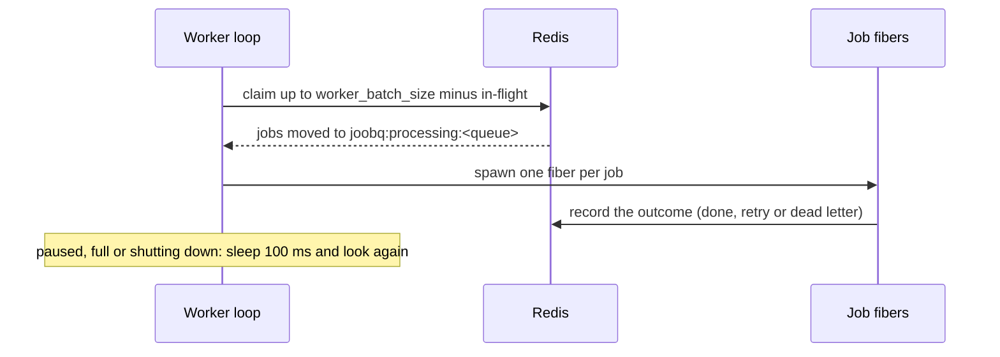

# Workers and concurrency

*Explanation · Core*

A worker is a fiber loop that claims jobs and runs each one in a fiber of its own. How many jobs run at once is workers times `worker_batch_size`, per process, and a clean stop puts unfinished work back on its queue.

## When to use it

- **Size a queue for a slow API.** Two workers with a batch size of 3 hold at most six calls open in each process.
- **Deploy without losing jobs.** A SIGTERM lets running jobs finish, and returns the ones still running at the deadline to their queue.
- **Scale out.** Several processes can serve the same queue; each runs its own workers against the same Redis list.

## How it works



Each loop claims as many jobs as it has free slots, so the batch size is a cap on in-flight jobs per worker, not a prefetch count. `CRYSTAL_WORKERS` is a Crystal runtime setting: JoobQ does not read it, and it does not change the number of JoobQ workers.

## Example

<!-- example: core/concurrency.cr -->
```crystal
require "joobq"

struct ResizeImageJob
  include JoobQ::Job

  @queue = "images"
  @@running = Atomic(Int32).new(0)
  @@peak = Atomic(Int32).new(0)
  @@done = Atomic(Int32).new(0)
  getter image_id : Int32

  def initialize(@image_id : Int32)
  end

  def self.peak
    @@peak.get
  end

  def self.done
    @@done.get
  end

  def perform
    @@peak.max(@@running.add(1) + 1)
    sleep 200.milliseconds
    @@running.sub(1)
    @@done.add(1)
  end
end

JoobQ.configure do |config|
  config.rest_api_enabled = false
  config.worker_batch_size = 3
  queue "images", 2, ResizeImageJob
end

12.times { |id| ResizeImageJob.enqueue(image_id: id) }
spawn { JoobQ.forge(trap_signals: false) }
until ResizeImageJob.done == 12
  sleep 100.milliseconds
end
JoobQ.shutdown(5.seconds)
puts "Peak jobs in flight: #{ResizeImageJob.peak} (2 workers x worker_batch_size 3)"
```

Output of `crystal run concurrency.cr` (log lines omitted):

```
Peak jobs in flight: 6 (2 workers x worker_batch_size 3)
```

## Shutdown

`JoobQ.forge` traps SIGTERM, SIGINT and SIGHUP. The first signal stops claiming, waits for running jobs until the shutdown timeout (15 seconds by default) minus a reserve of up to 1 second, then returns the jobs still running to their queue. These exit codes were observed with a worker running a 30-second job:

| Situation | Exit code |
| --- | --- |
| No job was running, or all finished in time | `0` |
| Jobs were still running at the deadline and were put back on their queue | `3` |
| A second signal more than 1 second after the first | `1`, without waiting |

## Options

| Parameter | Type | Default | Description |
| --- | --- | --- | --- |
| `workers` (in `queue`) | `Int32` | none | Worker loops for the queue in this process, 1 to 1000 |
| `worker_batch_size` | `Int32` | `10` | Most jobs one worker holds at once, 1 to 1000 |
| `shutdown_timeout` (in `forge`) | `Time::Span` | `15.seconds` | Time the first signal gives running jobs |
| `JOOBQ_TRAP_SIGNALS` | env | on | `0`, `false` or `no`: `forge` installs no signal handler |
| `REDIS_POOL_SIZE` | env | `500` | Redis connections per process |


A job put back at shutdown runs again from the start on the next worker. Its `perform` may have done part of the work already: make it safe to repeat.



**JoobQUI.** The Workers page shows each worker process that runs `JoobQ::WorkerRegistry.new.start`, with its heartbeat and the CPU and memory (RSS) it reports. Changing a queue's concurrency from the console stores the new count in Redis (`joobq:queue:<name>:config`).


## Next steps

- [Tune concurrency and shutdown](../how-to/tune-concurrency-and-shutdown.md): pick numbers for your queues.
- [Rate limiting and throttling](rate-limiting-and-throttling.md): limit starts per second instead of jobs at once.
- [Deploy workers](../how-to/deploy-workers.md): give the supervisor a stop timeout longer than the shutdown timeout.
