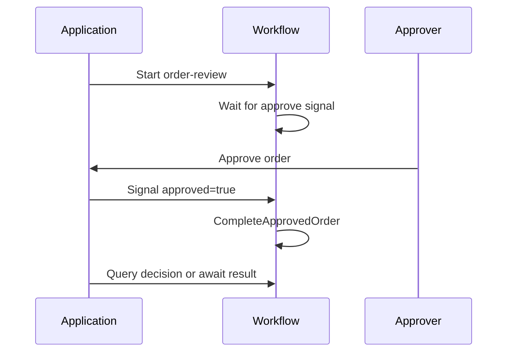

# Wait for approval

An order needs a decision before it can continue. Use a signal wait rather than leaving an activity polling for approval. The engine records the signal payload in workflow history.

**Requires:** the [Pro v0.2.2 setup](../introduction/adding-pro.md) and development Redis. This complete example sends its own approval so you can run it from one terminal. It does not charge a card or update an order database.


<!-- example: pro/approval_workflow.cr -->
```crystal
require "joobq_pro"
include JoobQPro::Workflows::DSL

struct ReviewInput
  include JSON::Serializable
  getter order_id : Int64
  getter approved : Bool
end

class CompleteApprovedOrder
  def perform(input : ReviewInput, context : JoobQPro::Workflows::ActivityContext) : String
    raise JoobQPro::Workflows::NonRetryableError.new("Order rejected") unless input.approved
    "Approved order #{input.order_id}"
  end
end

OrderReview = workflow "order-review", timeout: 1.minute do
  wait_for :approval, signal: :approve, timeout: 30.seconds
  step :complete, CompleteApprovedOrder,
    input: {order_id: input(:order_id), approved: output(:approval, :approved)}
  query :approval, output(:approval)
end

JoobQ.configure { |config| config.rest_api_enabled = false }
worker = JoobQPro::Workflows::Worker.new(activity_workers: 1, orchestrators: 1, scheduler: false)
begin
  worker.register(OrderReview).start
  id = worker.client.start("order-review", {order_id: 42_i64})
  raise "Signal was not accepted" unless worker.client.signal(id, "approve", {approved: true})
  result = worker.client.result(id, timeout: 10.seconds)
  raise "Unexpected result" unless result["complete"].as_s == "Approved order 42"
  raise "Approval missing" unless worker.client.query(id, "approval")["approved"].as_bool
  puts result["complete"].as_s
ensure
  JoobQPro.shutdown
  JoobQ.shutdown
end
```


```sh
crystal run src/review_order.cr
```

Expect `Approved order 42`. `wait_for` bounds the wait; `output(:approval, :approved)` passes the decision into typed activity input. `query` exposes the recorded decision without changing the workflow.



In your app, keep the returned run ID with the order. An authenticated endpoint can send the signal from a separate `JoobQPro::Workflows::Client`; authorize the business decision before doing so. Do not trust an order ID supplied by a caller as proof of access.

Repeated signals are messages, not an automatic deduplication mechanism. Deduplicate approval requests in your application when necessary. A query before approval can return null. Handle a declined decision or wait timeout as a failure; the demo intentionally exercises the approved path.

**Next:** [Handle failures](handle-failures.md) or [compensate completed work](../design-patterns/sagas.md).
