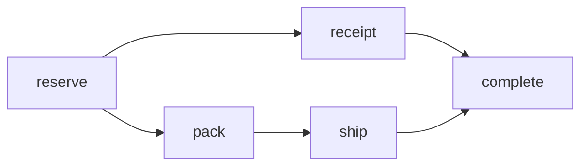

# Fan out and join

*How-to · Pro*

## Prerequisites

- A workflow you can edit ([Build and run workflows](build-and-run-workflows.md)).

## Steps

1. Put the independent steps in a `parallel` block, and steps that must run in order inside it in a `sequence`:

<!-- illustrative: inside a workflow after a reserve step, with application-defined activities -->
```crystal
parallel do
  step :receipt, SendReceipt, input: output(:reserve)

  sequence do
    step :pack, PackOrder
    step :ship, ShipOrder, input: output(:pack)
  end
end

step :complete, CompleteOrder
```
2. Add the joining step after the block; it waits for every branch.
3. Pass results explicitly with `input: output(:step)`; an omitted input is the workflow's input.
4. Do not read a sibling branch's output inside the block; add `after:` or move the consumer after the block.

## Verify

The run's history shows the branches starting together after `reserve`, and the join after both:



## See also

- [Workflows and sagas](../explanation/durable-workflows.md)
- [Build a parallel workflow with the DSL](../tutorials/parallel-workflow-dsl.md)
