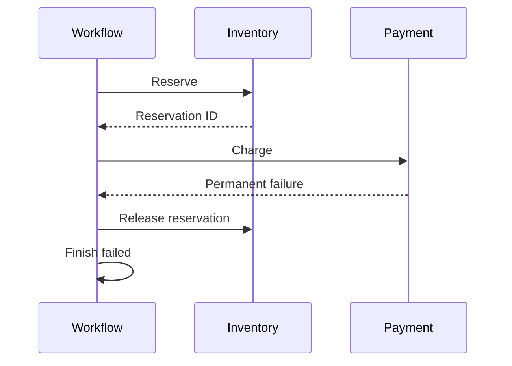

# Compensate with a saga

*How-to · Pro*

## Prerequisites

- Pro installed ([Add Pro](add-pro.md)) and a development Redis.

## Steps

1. For each step whose effect can be undone, declare `compensate: compensation(UndoActivity, input: output(:step))`:


<!-- example: pro/compensation_workflow.cr -->
```crystal
require "joobq_pro"
include JoobQPro::Workflows::DSL

# A visible test effect, not a durable inventory database.
module DemoInventory
  RELEASED = Atomic(Bool).new(false)
end

class ReserveInventory
  def perform(order_id : Int64, context : JoobQPro::Workflows::ActivityContext) : Int64
    order_id
  end
end

class ReleaseInventory
  def perform(reservation_id : Int64, context : JoobQPro::Workflows::ActivityContext) : Int64
    DemoInventory::RELEASED.set(true)
    reservation_id
  end
end

class DeclinePayment
  def perform(order_id : Int64, context : JoobQPro::Workflows::ActivityContext) : String
    raise JoobQPro::Workflows::NonRetryableError.new("Card declined")
  end
end

Checkout = workflow "compensated-checkout", timeout: 1.minute do
  step :reserve, ReserveInventory,
    compensate: compensation(ReleaseInventory, input: output(:reserve))
  step :charge, DeclinePayment
end

JoobQ.configure { |config| config.rest_api_enabled = false }
worker = JoobQPro::Workflows::Worker.new(activity_workers: 1, orchestrators: 1, scheduler: false)
begin
  worker.register(Checkout).start
  id = worker.client.start("compensated-checkout", 42_i64)
  begin
    worker.client.result(id, timeout: 10.seconds)
    raise "Expected payment failure"
  rescue error : JoobQPro::Workflows::WorkflowFailed
    raise "Unexpected failure" unless error.failure.try(&.["message"].as_s) == "Card declined"
    raise "Reservation was not released" unless DemoInventory::RELEASED.get
    puts "PASS failed payment released its reservation"
  end
ensure
  JoobQPro.shutdown
  JoobQ.shutdown
end
```

2. Give compensations their own timeouts, a stable business key and an owner for runs that end `compensation_incomplete`; compensations do not inherit the step's retry policy.
3. Run it: `crystal run src/compensated_checkout.cr`.

## Verify

The program prints `PASS failed payment released its reservation`: `charge` failed, `ReleaseInventory` ran, and the run ended failed.



## See also

- [Workflows and sagas](../explanation/durable-workflows.md)
