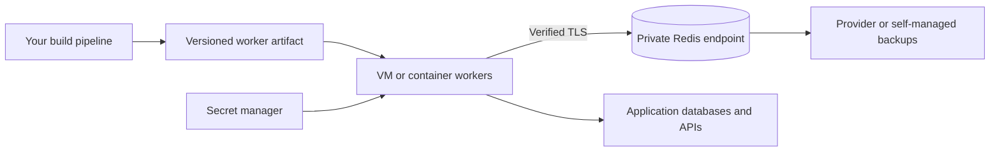

# JoobQ Cloud

Run JoobQ on the cloud infrastructure you already use. You deploy the Crystal workers, connect them to a compatible Redis service, and keep ownership of your application code and business effects.

In these docs, **JoobQ Cloud means cloud-hosting guidance**. The examples use existing JoobQ configuration and your infrastructure provider's tools.

## Choose a starting topology

| Option | Good fit | Your operational work |
| --- | --- | --- |
| VM workers + managed Redis | A small deployment with familiar process supervision | Build workers, configure networking, supervise processes, validate provider recovery |
| Container workers + managed Redis | Teams with an existing image/deployment pipeline | Supply secrets, resource limits, shutdown budgets, and worker metrics |
| Kubernetes workers + compatible Redis | Teams already operating Kubernetes | Manage rollout behavior, scheduling, network policy, and recovery across replicas |
| Workers + self-managed Redis | Teams needing control over Redis persistence and operations | All of the above, plus Redis upgrades, storage, backups, and failover |

## Bring the application with you

1. Build the [supported dependency pair](../introduction/compatibility.md) into a versioned artifact.
2. Provision private connectivity and the Redis commands your enabled features need. Validate Lua, persistence, and failover on the exact service tier.
3. Inject credentials and CA trust at runtime. Keep build-time private-shard access separate from runtime credentials.
4. Start a worker, complete a representative canary, and test termination before sending normal traffic.
5. Assign owners for queue backlog, failed work, backups, and recovery.

Start with [application preparation](prepare-your-application.md), then use the [VM worker service](../production-deployment/deploy-workers.md) or [Kubernetes example](kubernetes.md).

Managed Redis takes care of some infrastructure operations. It does not execute your Crystal activities or establish end-to-end exactly-once effects. Check your provider's quotas, regions, persistence settings, and recovery guarantees before choosing a service tier.
