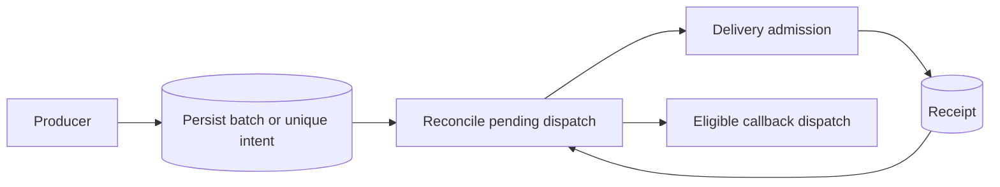

# Distributed coordination

These controls solve different problems. A queue worker count limits local execution; a rate limit bounds admissions over time; uniqueness suppresses competing work for a key; a batch tracks a set of jobs. None substitutes for external-effect idempotency.

## Durable batches and uniqueness

**Pro / Preview:** `JoobQPro::Durable::Batches` and `JoobQPro::Durable::UniqueJobs` receive an explicit `JoobQ::Delivery::Runtime`. The batch façade also requires that service; do not use old examples that assume any `Job.enqueue` call automatically becomes a batch member.

A batch persists membership before sealing. Reconciliation publishes pending members and follows receipts. Callback dispatch is recoverable work, so callback handlers must tolerate repetition.

Unique admission records a key and owner. A stale owner must not release a newer owner's claim. Choose a uniqueness mode and retention period that match the business operation; a short TTL is not a permanent duplicate-prevention guarantee.

## Atomic rate limiting

The released limiter exposes `RateLimiter.reserve` with a `RateLimit`. Reservation happens before execution using Redis state. A failed execution consumes its permit; an unknown Redis result must not be treated as approval. Separate advisory checks and later increments are not an atomic admission decision.

The [executable coordination fixture](../../examples/docs/pro/coordination.cr) shows batch admission, uniqueness, and concurrent reservations against a shared limit; the behavior is also covered by Pro's durable service tests. Use the higher-level middleware only after checking how it treats a denied permit in your chosen processing API.

## Capacity is still finite

Size runtime capacity, worker counts, Redis pools, and downstream pools together. Per-process capacity is not a fleet-wide semaphore. If your business needs a global maximum of simultaneously running external operations, verify an implemented control for that exact scope; this guide does not invent a `global_concurrency` setting.

**Next:** [Concurrency and shutdown](../configuration/concurrency.md).
