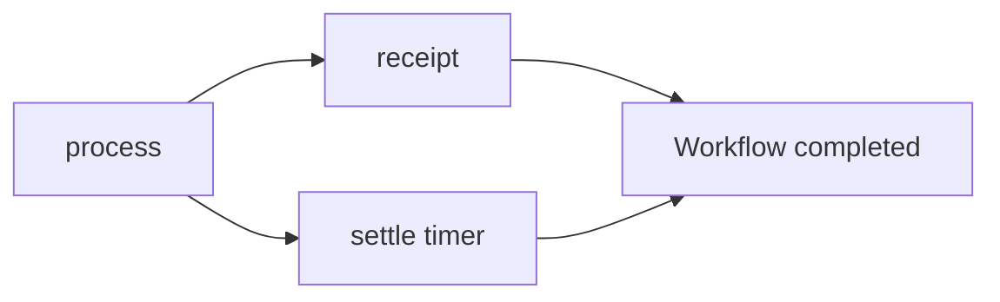

# Workflow DSL — Preview

Write workflow orchestration like ordinary Crystal. Reusable activity classes perform the work; the DSL builds the same persisted definitions used by the existing engine.


Available starting with **JoobQ Pro v0.2.2**. The authoring API remains a **Preview**, built on the existing workflow engine. Pro v0.2.0 and v0.2.1 do not include it. Existing constructors remain supported. Start with the [first workflow](../../quick-start/first-workflow.md) for the smallest runnable example, or follow this parallel workflow walkthrough.


With authorized Pro repository access, install the documented release:


```yaml
dependencies:
  joobq_pro:
    github: azutoolkit/joobq-pro
    version: "= 0.2.2"
```


Run `shards install` and retain the resolved `shard.lock`. Use the Core revision required by that Pro manifest; do not independently upgrade it. The [compatibility guide](../../introduction/compatibility.md) records the exact release commit and dependency pair.

## Your first declarative workflow

This complete program processes an order, passes its result to a receipt activity, and runs that receipt alongside a durable timer. It uses no real payment or email service.


<!-- example: pro/workflow_dsl.cr -->
```crystal
require "joobq_pro"
include JoobQPro::Workflows::DSL

struct OrderInput
  include JSON::Serializable
  getter order_id : Int64
end

class ProcessOrder
  def perform(input : OrderInput, context : JoobQPro::Workflows::ActivityContext) : String
    "Processed order #{input.order_id}"
  end
end

class SendReceipt
  def perform(input : String, context : JoobQPro::Workflows::ActivityContext) : String
    "Receipt: #{input}"
  end
end

Checkout = workflow "checkout", timeout: 1.minute do
  step :process, ProcessOrder,
    retry: retry_policy(attempts: 3, initial: 1.second)

  parallel do
    step :receipt, SendReceipt, input: output(:process)
    timer :settle, for: 10.milliseconds
  end
end

JoobQ.configure { |config| config.rest_api_enabled = false }
worker = JoobQPro::Workflows::Worker.new(activity_workers: 2, orchestrators: 1, scheduler: false)
begin
  worker.register(Checkout).start
  id = worker.client.start("checkout", {order_id: 42_i64})
  result = worker.client.result(id, timeout: 10.seconds)
  raise "Unexpected workflow result" unless result["receipt"].as_s == "Receipt: Processed order 42"
  puts result["receipt"].as_s
ensure
  JoobQPro.shutdown
  JoobQ.shutdown
end
```


Run it with `crystal run src/workflow.cr` against your development Redis. Expect `Receipt: Processed order 42`. The example stops Pro and Core in that order.

## Read the flow from top to bottom

Steps run sequentially unless you put them in `parallel`. Every parallel branch starts after the preceding sequence; a following step waits for all branches under the existing engine's completion rules. Use `sequence` inside `parallel` for an ordered branch. Groups add dependency edges, not hidden jobs.



Omitted activity input means the original workflow input. Result chaining is explicit: `input: output(:process)`. Step IDs must be unique across the workflow, including inside groups.

`Checkout` is a `Blueprint`. Inspect `Checkout.definition.to_json` without connecting to Redis. `worker.register(Checkout)` installs its activity handlers and publishes the definition; a client can publish it without installing handlers. Defining a workflow does not execute activities or start workers.

[Screenshot: The terminal workflow inspector showing checkout with process completed, parallel receipt and settle steps, their real statuses, and the persisted definition hash.]

Continue with the [DSL reference](reference.md), [lifecycle controls](lifecycle.md), and [migration guide](migration.md).
