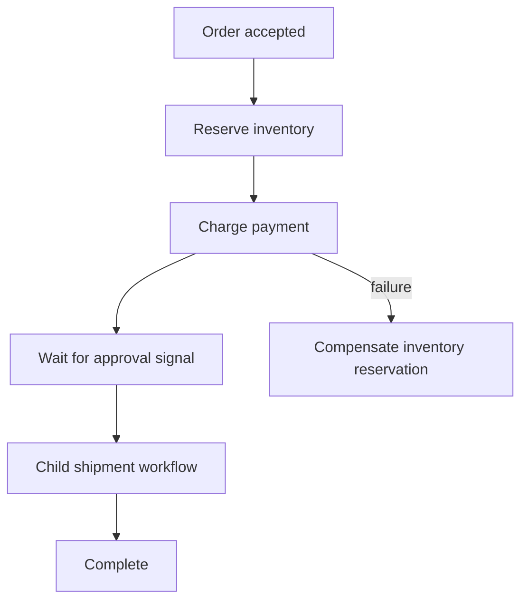

# Durable workflows

A workflow is a graph of steps. An activity does work; a signal waits for outside input; timers and child workflows express other dependencies. The engine derives state from a Redis history and records decisions before continuing orchestration.

This is an illustrative order design, not a bundled payment implementation. Use the [runnable first workflow](../quick-start/first-workflow.md) to learn the actual API.


Use the [typed workflow DSL](workflow-dsl/README.md), available since **Pro v0.2.2**. Steps run sequentially by default; `parallel` creates concurrent branches and `sequence` orders steps within a branch. The authoring API remains a preview. Existing constructors remain supported; see the [migration guide](workflow-dsl/migration.md).


## Activities and failure boundaries

Declare activities with `step :name, ActivityClass`, then call `worker.register(blueprint).start`. Registration installs the typed handlers and publishes the definition; constructing a blueprint does neither. Use typed input and `ActivityContext`. `context.dedupe_key` identifies the external effect across attempts; `heartbeat` and `cancel_requested?` help long activities cooperate with the engine.

Definitions expose retry policies, timeouts, dependencies, conditions, compensation, and child workflows. A compensation is another operation that can fail or repeat. It is not a distributed database rollback.

## History is the authority

Inspect through the workflow client: `describe`, `history`, `query`, and `result`. Live event announcements help a UI stay current, but consumers must detect sequence gaps and resynchronize from history. Retention, archival, and recovery need explicit policies; do not prune active runs.

The baseline uses a Redis history store. A PostgreSQL History Store is not supplied by these releases. Do not configure a fictional PostgreSQL adapter based on the presence of CQL elsewhere in the toolkit.

## Schedules and deployments

Workflow schedules support cron or intervals, timezone handling, overlap policies, catch-up windows, and bounded backfill. Choose `Skip`, `BufferOne`, `AllowAll`, or `CancelPrevious` according to the business effect. Preview backfill scope before running it.

Build IDs and compatible build sets help route runs during upgrades. A compatibility declaration is a promise from your application: old persisted inputs and workflow behavior must still make sense on the new workers. Test a running workflow across the deployment, not just a newly started one.

## Stop in order

Stop Pro workers and collectors before the underlying Core runtime. The first workflow fixture demonstrates `JoobQPro.shutdown` followed by `JoobQ.shutdown`. Set a supervisor grace period that accommodates both drains and record incomplete shutdowns.

**Next:** [Recovery](../best-practices/recovery.md).
