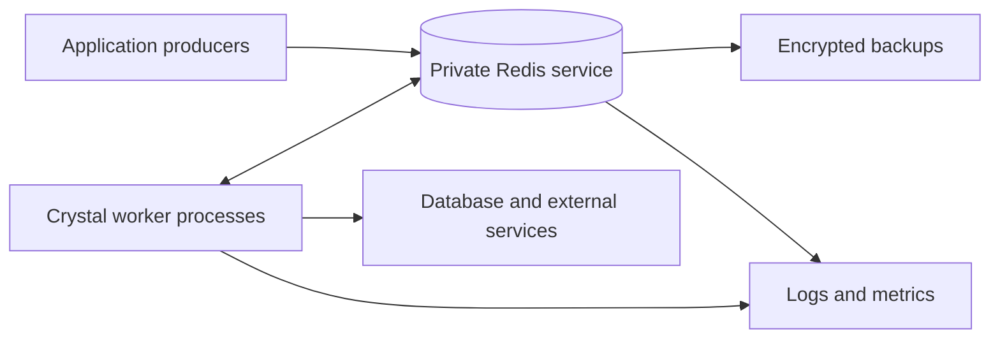

# Production Deployment

Your application owns its producers, worker processes, and business effects. Redis holds queue state and, for Pro workflows, execution history. Deploy and operate those pieces together.

A practical starting point is a separately deployed worker service, a private Redis endpoint with verified TLS, and explicit database/provider credentials. A managed Redis service can run the storage layer; it does not run your Crystal handlers for you.

| Task | Guide |
| --- | --- |
| Build, run, and stop worker processes | [Deploy workers](deploy-workers.md) |
| Configure durable Redis and rehearse recovery | [Redis and recovery](redis-and-recovery.md) |
| Monitor capacity and roll out compatible changes | [Operate and upgrade](operate-and-upgrade.md) |
| Run on cloud VMs, containers, or Kubernetes | [JoobQ Cloud](../joobq-cloud/README.md) |

Use the [documented dependency pair](../introduction/compatibility.md). Start by agreeing on acceptable loss of acknowledged work (RPO), recovery time (RTO), and completion-latency objectives. Then test the actual deployment against them.


These guides are deployment recipes, not certification of a particular Redis provider or infrastructure topology. The documented release uses single-Redis coordination; do not assume Redis Cluster, failover proxies, or every managed-service command policy is compatible without testing.

