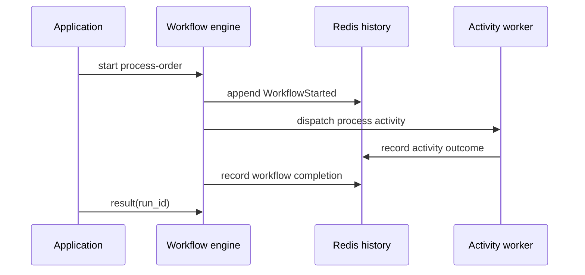

# Your first Pro workflow

Install the [Pro dependency setup](../introduction/adding-pro.md) first. This example uses the typed DSL in **Pro v0.2.2** and its pinned Core revision, with the management API off. The authoring API remains a preview; existing constructors are still supported. It has no real external side effect.


<!-- example: pro/first_workflow.cr -->
```crystal
require "joobq_pro"
include JoobQPro::Workflows::DSL

struct OrderInput
  include JSON::Serializable
  getter order_id : Int64
end

class ProcessOrder
  def perform(input : OrderInput, context : JoobQPro::Workflows::ActivityContext) : String
    "Processed order #{input.order_id}"
  end
end

ProcessOrderWorkflow = workflow "process-order", timeout: 1.minute do
  step :process, ProcessOrder
end

JoobQ.configure { |config| config.rest_api_enabled = false }
worker = JoobQPro::Workflows::Worker.new(activity_workers: 1, orchestrators: 1, scheduler: false)
begin
  worker.register(ProcessOrderWorkflow).start
  id = worker.client.start("process-order", {order_id: 42_i64})
  result = worker.client.result(id, timeout: 10.seconds)
  raise "Unexpected workflow result" unless result["process"].as_s == "Processed order 42"
  puts result["process"].as_s
ensure
  JoobQPro.shutdown
  JoobQ.shutdown
end
```


```sh
crystal run src/workflow.cr
```

Expect `Processed order 42`. A missing or invalid license may also produce startup warnings; see [Pro access](../configuration/access.md). This example waits for its result and shuts down. A service normally keeps its worker alive and admits runs from a separate producer.

## What changed from a regular job?

The activity has typed input and an `ActivityContext`. `workflow` returns a validated `Blueprint`; `step` binds the activity class without executing it. Worker registration publishes its definition and installs the handler. The engine records transitions in Redis history and dispatches the work. An activity can run again after a retry, so use `context.dedupe_key` with an external service that supports idempotency.



## Add another step

Steps run from top to bottom. Omitted activity input uses the original workflow input; use `input: output(:process)` to pass a prior result explicitly. Use `parallel` for concurrent branches and `sequence` for an ordered branch. These groups add graph dependencies, not extra jobs.

See the [runnable parallel workflow](../pro/workflow-dsl/README.md), [complete DSL reference](../pro/workflow-dsl/reference.md), and [lifecycle controls](../pro/workflow-dsl/lifecycle.md). If you already have constructor-based definitions, follow the [migration guide](../pro/workflow-dsl/migration.md).
