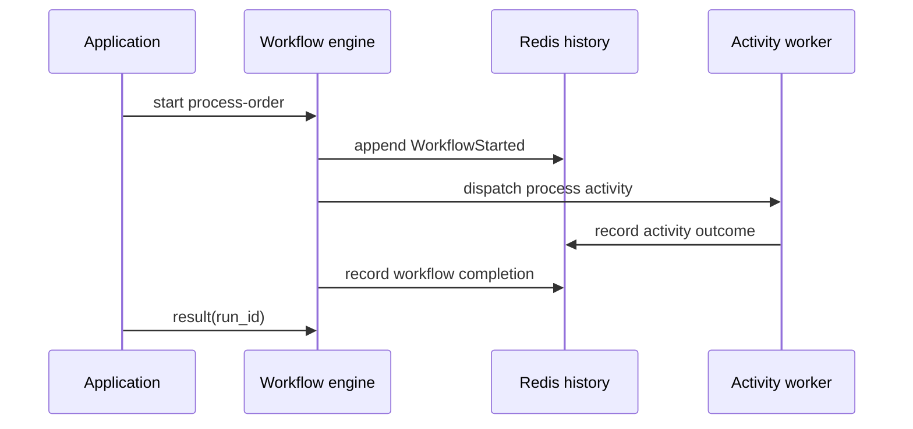

# Your first Pro workflow

Install the [Pro dependency setup](../introduction/adding-pro.md) first. This example uses Pro `v0.2.0` and its pinned Core revision, with the management API off. It has no real external side effect.


<!-- example: pro/first_workflow.cr -->
```crystal
require "joobq_pro"
include JoobQPro::Workflows

struct OrderInput
  include JSON::Serializable
  getter order_id : Int64
end

class ProcessOrder
  def perform(input : OrderInput, context : ActivityContext) : String
    "Processed order #{input.order_id}"
  end
end

register_activity ProcessOrder

JoobQ.configure { |config| config.rest_api_enabled = false }
definition = Definition.new("process-order", [
  Step.activity("process", "ProcessOrder", input: JSON.parse(%({"order_id":"${input.order_id}"}))),
]).validate!

worker = Worker.new(activity_workers: 1, orchestrators: 1, scheduler: false)
worker.register(definition).start
begin
  id = worker.client.start("process-order", {order_id: 42_i64})
  result = worker.client.result(id, timeout: 10.seconds)
  puts result["process"].as_s
ensure
  JoobQPro.shutdown
  JoobQ.shutdown
end
```


```sh
crystal run src/workflow.cr
```

Expect `Processed order 42`. A missing or invalid license may also produce startup warnings; see [Pro access](../configuration/access.md). This example waits for its result and shuts down. A service normally keeps its worker alive and admits runs from a separate producer.

## What changed from a regular job?

The activity has typed input and an `ActivityContext`. A workflow definition names the activity; the engine records transitions in Redis history and dispatches the work. An activity can run again after a retry, so use `context.dedupe_key` with an external service that supports idempotency.



**Next:** [Add dependencies, signals, and recovery](../pro/workflows.md).
