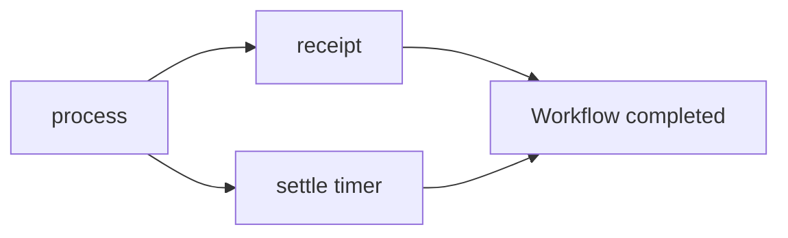

# Build a parallel workflow with the DSL

*Tutorial · Pro · Preview*

You will build a checkout workflow in which a receipt and a settlement timer run at the same time after the order is processed, and print the receipt. Start from the `order_workflow` project of [Your first Pro workflow](first-pro-workflow.md).



## Write the workflow

Create `src/checkout.cr`:


<!-- example: pro/workflow_dsl.cr -->
```crystal
require "joobq_pro"
include JoobQPro::Workflows::DSL

struct OrderInput
  include JSON::Serializable
  getter order_id : Int64
end

class ProcessOrder
  def perform(input : OrderInput, context : JoobQPro::Workflows::ActivityContext) : String
    "Processed order #{input.order_id}"
  end
end

class SendReceipt
  def perform(input : String, context : JoobQPro::Workflows::ActivityContext) : String
    "Receipt: #{input}"
  end
end

Checkout = workflow "checkout", timeout: 1.minute do
  step :process, ProcessOrder,
    retry: retry_policy(attempts: 3, initial: 1.second)

  parallel do
    step :receipt, SendReceipt, input: output(:process)
    timer :settle, for: 10.milliseconds
  end
end

JoobQ.configure { |config| config.rest_api_enabled = false }
worker = JoobQPro::Workflows::Worker.new(activity_workers: 2, orchestrators: 1, scheduler: false)
begin
  worker.register(Checkout).start
  id = worker.client.start("checkout", {order_id: 42_i64})
  result = worker.client.result(id, timeout: 10.seconds)
  raise "Unexpected workflow result" unless result["receipt"].as_s == "Receipt: Processed order 42"
  puts result["receipt"].as_s
ensure
  JoobQPro.shutdown
  JoobQ.shutdown
end
```




## Run it

```sh
crystal run src/checkout.cr
```

After the licence warning (if you have no `JOOBQ_PRO_LICENSE`), you should see:

```
Receipt: Processed order 42
```



The run looked like this: `process` first, then `receipt` and the `settle` timer in parallel, and the workflow completed when both had finished.



## Next steps

- [Workflow DSL](../reference/workflow-dsl.md): every DSL method.
- [Fan out and join](../how-to/fan-out-and-join.md): the pattern in your own workflows.
- [Workflows and sagas](../explanation/durable-workflows.md): why steps are recorded in a history.
